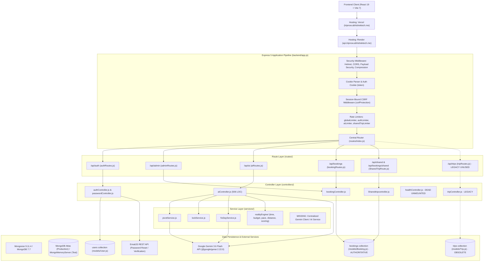
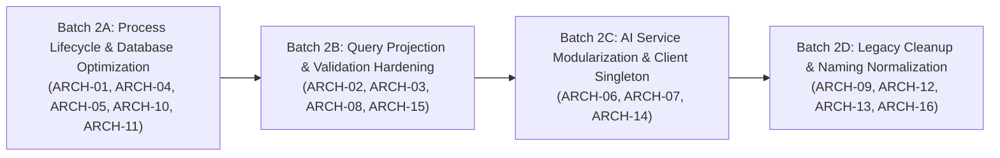

# TripNow — Phase 2: Backend Architecture & Maintainability Audit

**Author:** Senior Node.js Backend Architect, Express.js Engineer, MongoDB/Mongoose Specialist, Application Performance Engineer  
**Date:** 2026-10-31  
**Project:** TripNow AI-Powered Travel Planner  
**Status:** **AUDIT COMPLETE — READY FOR IMPLEMENTATION**  

---

## 1. Executive Summary

This report delivers a comprehensive, read-only architectural and maintainability audit of the TripNow backend following the successful completion and approval of Phase 1 (Security Hardening & Dependency Remediation).

### Audit Highlights & Architectural Posture:
- **Zero Critical P0 Vulnerabilities:** Phase 1 successfully established robust defenses against all major attack vectors: HttpOnly authentication cookies, session-bound CSRF validation with timing-safe checks, rate limiting, exact-origin CORS, security headers, prototype-pollution defenses, and privacy-preserving public shared trip DTO sanitization.
- **Authoritative Entity Verification (Trip vs. Booking):** The dual-model ambiguity has been resolved through code-path tracing. `Booking.js` is the true, authoritative domain model powering AI generation, dashboard management, reality scoring, and public sharing. `Trip.js` and `/api/trips` are dead legacy prototypes unreferenced by any frontend page or production workflow.
- **Primary Architectural Debt Identified:**
  1. **Monolithic AI Controller:** `aiController.js` (506 lines) tightly couples prompt engineering, Google Gemini SDK instantiation, date calculations, and MongoDB document persistence directly inside HTTP route handlers without an `aiService.js` abstraction.
  2. **Unbounded / Unprojected Query Payloads:** `getMyBookings` retrieves all saved user trips without pagination and without field projection, returning massive nested `aiPlan` JSON payloads (20–50KB per document) to the frontend Dashboard listing.
  3. **Missing Compound & Token Database Indexes:** Frequently queried query/sort combinations (`{ user: 1, createdAt: -1 }` on `Booking`, and token lookup fields `{ resetTokenHash: 1 }`, `{ verifyTokenHash: 1 }` on `User`) lack targeted indexes, causing in-memory sorts and full collection scans.
  4. **Error Handling & Response Inconsistencies:** Bypasses of `next(error)` in `authController.js` and `aiController.js`, inline `require()` calls scattered in `aiController.js`, and ad-hoc `res.json` responses that bypass `utils/response.js`.
  5. **File Naming & Dead Modules:** Inconsistent casing in `Sharedtripcontroller.js` / `SharedTripRoute.js` and dead code in `healthController.js`.
  6. **Process Lifecycle:** Absence of graceful shutdown handlers (`SIGTERM` / `SIGINT`) and unhandled rejection hooks in `server.js`.

---

## 2. Current Backend Architecture Diagram



---

## 3. Folder Structure & Separation of Concerns

### Structure Overview
```
backend/
├── app.js                          <-- Express pipeline & middleware registration
├── server.js                       <-- Process entrypoint & HTTP server startup
├── config/
│   ├── authCookie.js               <-- Cookie options, maxAge alignment, duration parser
│   ├── db.js                       <-- Mongoose Atlas connection helper
│   └── env.js                      <-- Environment variable parsing & validation
├── controllers/
│   ├── aiController.js             <-- AI generation, pivot, lock, reality, fix-day handlers
│   ├── authController.js           <-- Signup, login, getMe, logout
│   ├── bookingController.js        <-- Authoritative trip CRUD, admin listing, share/unshare
│   ├── healthController.js         <-- [ORPHANED] Unmounted health check handler
│   ├── passwordController.js       <-- Forgot/reset password, email verification
│   ├── Sharedtripcontroller.js     <-- [INCONSISTENT CASING] Public shared trip DTO
│   └── tripController.js           <-- [LEGACY UNUSED] Flat trip prototype handler
├── middleware/
│   ├── auth.js                     <-- JWT extraction & verification
│   ├── csrf.js                     <-- Stateless HMAC-SHA256 session-bound CSRF
│   ├── errorHandler.js             <-- 404 notFound & centralized 500 error sanitization
│   ├── optionalAuth.js             <-- Soft identity attribution for AI endpoints
│   ├── payloadSecurity.js          <-- Prototype pollution & NoSQL injection defense
│   ├── rateLimiters.js             <-- In-memory Express rate limiters
│   ├── requestId.js                <-- UUIDv4 tracing header (X-Request-Id)
│   ├── requireAdmin.js             <-- Role-based admin authorization guard
│   ├── security.js                 <-- Helmet & CORS exact-origin configuration
│   ├── validate.js                 <-- Zod validation middleware
│   └── validateObjectId.js         <-- MongoDB Hex ObjectId validation
├── models/
│   ├── Booking.js                  <-- AUTHORITATIVE Trip/Booking schema
│   ├── Trip.js                     <-- [LEGACY UNUSED] Obsolete flat trip schema
│   └── User.js                     <-- User accounts, roles, auth tokens
├── routes/
│   ├── adminRoutes.js              <-- Admin booking management
│   ├── aiRoutes.js                 <-- AI itinerary endpoints
│   ├── authRoutes.js               <-- Auth & password reset routes
│   ├── bookingRoutes.js            <-- Authoritative trip routes
│   ├── index.js                    <-- Central route aggregator & CSRF endpoint
│   ├── SharedTripRoute.js          <-- [INCONSISTENT CASING] Public shared trip routes
│   └── tripRoutes.js               <-- [LEGACY UNUSED] Obsolete trip routes
├── services/
│   ├── fixDayService.js            <-- AI Fix-Day preview & apply logic
│   ├── lockService.js              <-- Activity locking engine
│   ├── pivotService.js             <-- Adaptive Pivot AI recalculation
│   └── realityEngine/              <-- Deterministic itinerary scoring engine
├── utils/
│   ├── email.js                    <-- EmailJS integration
│   ├── itineraryNormalizer.js      <-- Structured activity normalizer
│   └── response.js                 <-- Envelope formatters: sendSuccess, sendError
└── validators/
    ├── aiValidators.js             <-- Zod schemas for AI routes
    ├── authValidators.js           <-- Zod schemas for auth routes
    ├── fixDayValidators.js         <-- Zod schemas for fix-day
    ├── lockValidators.js           <-- Zod schemas for lock
    ├── pivotValidators.js          <-- Zod schemas for pivot
    └── realityValidators.js        <-- Zod schemas for reality score
```

### Key Separation-of-Concerns Findings:
1. **Controller Bloat (`aiController.js`):** At 506 lines, `aiController.js` acts simultaneously as route handler, prompt generator, SDK client, response parser, date normalizer, and database layer.
2. **Missing Service Layer for AI & Bookings:** While `pivotService` and `realityEngine` have dedicated services, core itinerary generation (`generateAITrip`) is hardcoded inside the controller.
3. **Dead / Orphaned File (`healthController.js`):** `backend/controllers/healthController.js` defines a structured health check with process uptime, but is never imported by `routes/index.js` or `app.js`. `app.js` and `routes/index.js` use ad-hoc inline handlers instead.
4. **Naming Convention Inconsistencies:**
   - `Sharedtripcontroller.js` (capital `S`, lowercase `trip` and `controller`) vs. `bookingController.js` (standard camelCase).
   - `SharedTripRoute.js` (PascalCase singular `Route`) vs. `bookingRoutes.js` (camelCase plural `Routes`).

---

## 4. Controllers & Services Assessment

### Detailed Controller Findings:
1. **Direct Catch-Block Status Bypasses in `authController.js`:**
   In `signup`, `login`, and `getMe`, errors are caught with `catch (error)` and manually terminated via `return res.status(500).json(...)`.
   - *Issue:* Bypasses `errorHandler.js`. Fails to log `requestId` in error responses. Masks Mongoose validation errors or unique constraint conflicts (e.g. `E11000 duplicate key error` on email) as generic 500 server crashes instead of proper 400/409 client responses.
2. **Inline `require()` Statements in `aiController.js`:**
   `aiController.js` contains `require("../services/pivotService")` and `require("../services/lockService")` at lines 323–324, and `require("../services/fixDayService")` at line 431 in the middle of function declarations.
   - *Issue:* Degrades maintainability, hides module dependencies, and hinders static analysis.
3. **Missing Request-Level Validation in `bookingController.js`:**
   Unlike `authRoutes.js` and `aiRoutes.js` (which validate inputs using Zod schemas via `middleware/validate.js`), `bookingRoutes.js` performs zero request body validation on `POST /api/bookings` and `PUT /api/bookings/:id`. It relies entirely on Mongoose runtime schema casting.
4. **Mongoose 9 Deprecation in `updateBooking`:**
   Line 93 of `bookingController.js` uses `{ new: true }` instead of `{ returnDocument: 'after' }`, generating console warnings on trip edits.

---

## 5. MongoDB & Mongoose Query Assessment

### 1. Missing Indexes
| Model | Fields Queried | Current Index | Query Location | Performance Implication |
|---|---|---|---|---|
| `Booking` | `{ user: 1, createdAt: -1 }` | Single-field `{ user: 1 }` | `bookingController.js:33` (`getMyBookings`) | Causes an unindexed in-memory sort on every user dashboard page load. |
| `Booking` | `{ createdAt: -1 }` | None | `bookingController.js:143` (`getBookings` admin) | Full collection scan + in-memory sort for admin listings. |
| `User` | `{ resetTokenHash: 1, resetTokenExpires: 1 }` | None | `passwordController.js:76` (`resetPassword`) | Full collection scan on every password reset attempt. |
| `User` | `{ verifyTokenHash: 1, verifyTokenExpires: 1 }` | None | `passwordController.js:116` (`verifyEmail`) | Full collection scan on every email verification attempt. |

### 2. Unprojected and Unbounded Queries (`getMyBookings`)
In `bookingController.js`:
```javascript
const trips = await Booking.find({ user: req.user._id }).sort({ createdAt: -1 });
```
- **Unprojected:** Fetches the full document, including the massive `aiPlan` string (often 20–50KB per itinerary), `tripData`, and `realityScore`. For a user with 20 trips, this pulls ~1MB of raw JSON into Node.js process memory to render simple dashboard cards.
- **Unbounded:** Lacks pagination limits. If a user accumulates dozens of trips, memory usage and network transfer grow linearly.
- **Recommendation:** Implement field projection `.select("destination checkin checkout guests budget dayCount coverImage isShared createdAt")` for dashboard list views, reserving full `aiPlan` retrieval for `getBookingById`.

### 3. Connection Pooling & Event Lifecycle
In [`backend/config/db.js`](file:///d:/all%20project/Travel%20Website/backend/config/db.js):
- `maxPoolSize` is omitted, defaulting to 100 connections. On MongoDB Atlas M0 free tier (capped at 500 concurrent connections across all processes), unconstrained pooling across Render instances risks connection exhaustion.
- Event listeners (`disconnected`, `error`, `reconnected`) are absent on `mongoose.connection`.
- No connection teardown is registered for process termination (`SIGTERM`/`SIGINT`).

---

## 6. API Architecture & Response Consistency Assessment

### 1. Inconsistent Response Envelopes
The project provides [`backend/utils/response.js`](file:///d:/all%20project/Travel%20Website/backend/utils/response.js) with standard helpers (`sendSuccess`, `sendError`), but adoption is uneven:

| Endpoint / Controller | Success Format | Error Format | Conforms to `sendSuccess`? |
|---|---|---|---|
| `bookingController.js` | `{ success: true, message: "...", data: {...} }` | Standard `sendError` | **Yes (Mostly)** |
| `authController.js` | `{ success: true, message: "...", data: { user: {...} } }` | `{ success: false, message: "..." }` | **No** (Direct `res.status`) |
| `aiController.js:generateAITrip` | `{ success: true, data: text, tripId: "..." }` | `{ success: false, message: "..." }` | **No** (`tripId` outside `data`) |
| `Sharedtripcontroller.js` | `{ success: true, data: {...} }` | `{ success: false, message: "..." }` | **No** (Direct `res.status`) |
| `tripController.js` | `{ success: true, data: [...] }` | Next error handler | **No** (Direct `res.json`) |

### 2. HTTP Status Code Conventions
- Resource creation in `authController.js` and `bookingController.js` properly returns `201 Created`.
- Resource deletion in `bookingController.js` returns `200 OK` with `{ success: true, message: "..." }`.
- Public shared trip not found properly returns `404 Not Found` for private trips.

---

## 7. AI Architecture & Reliability Assessment

### 1. Tight Coupling & Repeated Instantiation
- `GoogleGenAI` is instantiated via `new GoogleGenAI({ apiKey })` on **every single incoming request** inside `aiController.js:198`, `pivotService.js:246`, and `fixDayService.js:314`.
- The deprecation fallback logic (detecting `404 ... no longer available to new users` and falling back to `gemini-3.6-flash`) is duplicated across three files.
- **Recommendation:** Centralize into a singleton `services/geminiClient.js`.

### 2. Request Timeout & Hang Prevention
- `generateAITrip` implements an `AI_GENERATION_TIMEOUT_MS = 25000` (25s) timeout via `Promise.race`, matching `pivotService` and `fixDayService`.
- Gemini error classification (`classifyGeminiError`) cleanly categorizes upstream failures (`rate_limited`, `timeout`, `model_unavailable`, `upstream_unavailable`, `auth`) into safe, non-leaking client HTTP codes (429, 502, 503, 504).

### 3. Rate Limiting & Compute Protection
- `aiLimiter` strictly caps AI calls to 10 requests per 15 minutes per IP.
- Optional authentication allows user identity attribution when present, with clean fallback for anonymous exploration.

---

## 8. Performance & Scalability Assessment

> [!NOTE]
> Synthetic load testing has not been executed against the live Render deployment. The findings below represent static code analysis of algorithmic complexity, payload sizes, and connection management.

1. **Memory Pressure on Dashboard Load:** Fetching unprojected documents with 50KB strings under `Booking.find({ user })` increases garbage collection pauses under high concurrent user load.
2. **In-Memory Rate Limiter Store:** `express-rate-limit` uses the default `MemoryStore`. If the backend is scaled horizontally across multiple Render instances, rate limit counters will not be shared. A Redis or external store is required only if horizontal scaling is enabled.
3. **Absence of Cache for Repeated Gemini Queries:** Identical destination prompts (e.g., standard "Goa 3 days") invoke full Gemini API round-trips every time. An in-memory cache (e.g. LRU with 1-hour TTL) for standard itinerary queries would significantly reduce token consumption and latency.

---

## 9. Error Handling & Logging Assessment

1. **Centralized Error Handler (`errorHandler.js`):**
   - Excellent production security: strips stack traces, logs request IDs, sanitizes 500 messages, handles Mongoose `ValidationError` and `CastError`, and intercepts prototype pollution attempts.
2. **Logging Inconsistencies:**
   - Logging is performed using raw `console.log` / `console.error` with inconsistent prefixes and emoji formats (`🚀 Calling Google Gemini`, `✅ Google Gemini responded`, `🔒 AI Controller Internal Error`).
   - A standardized logging utility or wrapper would provide structured JSON logging in production for Render log drains (Datadog/Logtail).
3. **Missing Process Crash Traps in `server.js`:**
   - `process.on("unhandledRejection")` and `process.on("uncaughtException")` are not registered. An unhandled promise rejection in any background service will crash the Node.js process.

---

## 10. Configuration & Environment Assessment

1. **Strengths:**
   - [`backend/config/env.js`](file:///d:/all%20project/Travel%20Website/backend/config/env.js) validates required environment variables at boot, enforces a minimum 32-character `CSRF_SECRET` in production, prevents `CSRF_SECRET === JWT_SECRET`, and sets IPv4 DNS resolution first.
2. **Gaps:**
   - `GEMINI_API_KEY` is not in `requiredVariables`. If omitted, the server boots but crashes on AI generation.
   - [`backend/utils/email.js`](file:///d:/all%20project/Travel%20Website/backend/utils/email.js) reads `process.env.EMAILJS_*` directly rather than accessing properties through `config/env.js`.
   - `isProduction` is calculated twice in `env.js` (lines 13 and 76).

---

## 11. Test Architecture Assessment

### Current Test Suite Baseline:
- **Suites:** 15 passing, 0 failing.
- **Tests:** 261 passing, 0 failing, 0 skipped.
- **Harness:** Jest 30.5.2, Supertest 7.3.1, MongoMemoryServer 11.3.0.

### Test Coverage Strengths:
- Deep coverage of authentication flows, cookies, CSRF tokens, rate limiting, and password reset.
- Complete privacy verification of public shared trip DTOs (`sharedTripPrivacy.test.js`).
- Reality scoring and deterministic calculations have extensive unit tests.
- Gemini API calls in `ai.test.js` are cleanly mocked via `jest.mock("@google/genai")`, enabling fast, deterministic CI execution without API keys.

### Gaps:
- Zero integration tests for `tripController.js` (further proving it is legacy dead code).
- No tests for `healthController.js`.
- Missing tests for input validation on `bookingRoutes.js` (because validation middleware is currently absent).

---

## 12. Legacy Architecture Investigation: `Trip.js` vs. `Booking.js`

### Rigorous Investigation Findings:

| Investigation Question | Evidence | Finding |
|---|---|---|
| **Does frontend code call `/api/trips`?** | `frontend/src/services/tripService.js` contains `/api/trips` calls, but **is never imported anywhere** in `frontend/src`. All components (`Dashboard.jsx`, `Booking.jsx`, `PlanTrip.jsx`) call `bookingService.js` (`/api/bookings`). | **No live frontend traffic touches `/api/trips`.** |
| **Which model does AI generation save to?** | `aiController.js:300` executes `Booking.create(...)`. | **`Booking` is the sole destination for AI itineraries.** |
| **Which model powers public shared trips?** | `Sharedtripcontroller.js:232` executes `Booking.findById(...)`. | **`Booking` is the sole model for shared trips.** |
| **Can `Trip.js` store modern itineraries?** | Schema only supports flat `itinerary: [{ day, activity }]`. Lacks `aiPlan`, `realityScore`, `isShared`, `coverImage`, and structured activities. | **`Trip.js` schema is structurally incompatible with current features.** |
| **Do backend tests rely on `Trip.js`?** | Only `securityMiddleware.test.js` tests generic ObjectId validation against `/api/trips/:id`. | **No business logic tests depend on `Trip.js`.** |

### Definitive Conclusion:
`models/Trip.js`, `controllers/tripController.js`, `routes/tripRoutes.js`, and `frontend/src/services/tripService.js` are legacy prototypes from early monolithic development. They have been entirely superseded by `Booking.js` and `bookingController.js`.

---

## 13. Prioritized Findings Table

| Finding ID | Priority | File | Location | Problem | Evidence | Impact | Recommendation | Risk | Dependencies | Test Requirements |
|---|---|---|---|---|---|---|---|---|---|---|
| **ARCH-01** | **P1** | `backend/server.js` | Lines 6–13 | Missing graceful shutdown and uncaught exception handlers. | No `SIGTERM`/`SIGINT` or `unhandledRejection` hooks. | Reliability: abruptly drops in-flight requests and database connections during Render deployments. | Add graceful shutdown closing Mongoose connection pool and HTTP server. | Low | `config/db.js` | Automated startup/shutdown test. |
| **ARCH-02** | **P1** | `backend/controllers/bookingController.js` | Line 33 | Unprojected and unbounded query in `getMyBookings`. | `Booking.find({ user }).sort({ createdAt: -1 })` fetches massive nested `aiPlan` strings for all user trips. | Performance: high memory usage and heavy payload transfer on Dashboard loads. | Add field projection (`.select(...)`) omitting `aiPlan` on list views. | Low | `frontend/src/pages/Dashboard.jsx` | Verify Dashboard loads cards without regression; test payload size. |
| **ARCH-03** | **P1** | `backend/controllers/authController.js` | Lines 62, 103, 137 | Controller error blocks swallow errors and bypass `errorHandler.js`. | `catch (error) { return res.status(500)... }` manually sends 500 without `next(error)`. | Reliability & Observability: masks validation/duplicate errors, strips `requestId`. | Refactor catch blocks to `next(error)` so centralized error handler processes them. | Low | `middleware/errorHandler.js` | Auth regression test suite (27/27 tests). |
| **ARCH-04** | **P2** | `backend/models/Booking.js` | Lines 12, 88 | Missing compound index on `{ user: 1, createdAt: -1 }`. | Only single field `{ user: 1 }` is indexed. Dashboard sort requires in-memory sort. | Performance: slow queries as user trip count grows. | Add compound index `bookingSchema.index({ user: 1, createdAt: -1 })`. | Low | `models/Booking.js` | Verify index creation in test DB. |
| **ARCH-05** | **P2** | `backend/models/User.js` | Lines 35–40 | Missing indexes on token lookup fields. | `resetTokenHash` and `verifyTokenHash` lack indexes. | Performance: collection scan on every password reset or email verification. | Add sparse indexes on `resetTokenHash` and `verifyTokenHash`. | Low | `models/User.js` | Password and verification test suites. |
| **ARCH-06** | **P2** | `backend/controllers/aiController.js` | Lines 1–320 | Monolithic AI controller lacking a service abstraction layer. | Prompt construction, Gemini SDK calls, schema definition, and persistence inside HTTP controller. | Maintainability: hard to test in isolation, high complexity (506 LOC). | Extract core Gemini generation logic into `services/aiService.js`. | Medium | `aiRoutes.js`, `ai.test.js` | AI test suite (303 LOC, all mock tests pass). |
| **ARCH-07** | **P2** | `backend/controllers/aiController.js`, `pivotService.js`, `fixDayService.js` | Multiple | Repeated Gemini SDK instantiation and duplicate model fallback logic. | `new GoogleGenAI({ apiKey })` and new-user deprecation logic repeated across 3 files. | Maintainability: duplicated upstream integration logic. | Create singleton `services/geminiClient.js` with shared fallback wrapper. | Low | `pivotService.js`, `fixDayService.js` | Pivot, Lock, FixDay, AI test suites. |
| **ARCH-08** | **P2** | `backend/routes/bookingRoutes.js` | Lines 21, 33 | Missing request body validation on booking creation and update. | `POST /api/bookings` and `PUT /api/bookings/:id` lack Zod validation middleware. | Reliability: unvalidated payload shapes fall through to Mongoose schema cast errors. | Add `validators/bookingValidators.js` and apply `validate(bookingSchema)`. | Low | `validators/`, `bookingRoutes.js` | Booking test suite (ownership, updates). |
| **ARCH-09** | **P2** | `backend/controllers/Sharedtripcontroller.js`, `routes/SharedTripRoute.js` | File names | Inconsistent file naming and casing conventions. | PascalCase + irregular lowercase: `Sharedtripcontroller.js` and `SharedTripRoute.js`. | Maintainability & Linux Portability: risk of case-sensitivity import bugs on Render. | Normalize to standard camelCase (`sharedTripController.js`, `sharedTripRoutes.js`). | Low | `routes/index.js`, `routes/SharedTripRoute.js` | Shared trip privacy test suite. |
| **ARCH-10** | **P2** | `backend/config/db.js` | Lines 6, 15 | Unconfigured connection pooling options. | `maxPoolSize` and connection event listeners omitted. | Reliability: potential pool exhaustion under burst traffic on Atlas M0. | Configure `maxPoolSize: 20`, `minPoolSize: 2`, and add connection event logging. | Low | `config/db.js` | Connection lifecycle tests. |
| **ARCH-11** | **P2** | `backend/controllers/bookingController.js` | Line 93 | Mongoose 9 deprecation warning in `updateBooking`. | Uses `{ new: true }` instead of `{ returnDocument: 'after' }`. | Maintainability: pollutes runtime logs with deprecation warnings. | Replace with `{ returnDocument: 'after' }`. | Low | `bookingController.js` | Booking update test suite. |
| **ARCH-12** | **P2** | `backend/models/Trip.js`, `controllers/tripController.js`, `routes/tripRoutes.js` | Multiple | Dead legacy model, controller, and route files. | Superseded by `Booking.js`. Uncalled by frontend. | Maintainability & Technical Debt: duplicate domain concepts confuse developers. | Deprecate and safely remove legacy Trip files after compatibility confirmation. | Medium | `routes/index.js`, `frontend/src/services/tripService.js` | Regression test suite. |
| **ARCH-13** | **P3** | `backend/controllers/healthController.js` | Entire file | Orphaned dead file. | Controller defined but never mounted to `/api/health` or `/health`. | Maintainability: dead code clutter. | Mount to `routes/index.js` as `/health` or remove. | Low | `routes/index.js` | Health endpoint test. |
| **ARCH-14** | **P3** | `backend/utils/email.js` | Lines 15–20 | Bypasses `config/env.js` module. | Directly reads `process.env.EMAILJS_*` rather than using centralized config. | Maintainability: breaks configuration centralization convention. | Route email config through `config/env.js`. | Low | `config/env.js` | Password reset email tests. |
| **ARCH-15** | **P3** | `backend/controllers/aiController.js` | Lines 323, 431 | Inline `require()` statements in middle of controller. | `require("../services/pivotService")` placed at lines 323 and 431. | Code Quality: violates standard top-of-file import conventions. | Hoist all `require()` calls to top of file. | Low | `aiController.js` | Linting & AI tests. |
| **ARCH-16** | **P3** | `backend/utils/response.js` | Multiple | Inconsistent adoption of `sendSuccess` across controllers. | Auth, AI, and SharedTrip controllers use ad-hoc `res.json` responses. | Consistency: varied response structures across API endpoints. | Standardize controllers to use `sendSuccess` without altering existing client contracts. | Low | All controllers | Full API test suites. |

---

## 14. Recommended Phased Implementation Roadmap

To maintain maximum safety and zero disruption to the working application, fixes should be implemented in four focused, reviewable batches:



### **Batch 2A — Process Lifecycle & Database Optimization**
- **Objective:** Add graceful shutdown, connection pool safeguards, missing indexes, and resolve Mongoose 9 deprecation warnings.
- **Complexity:** Low.
- **Files Modified:** `backend/server.js`, `backend/config/db.js`, `backend/models/Booking.js`, `backend/models/User.js`, `backend/controllers/bookingController.js`.
- **Target Findings:** ARCH-01, ARCH-04, ARCH-05, ARCH-10, ARCH-11.
- **Regression Risk:** Zero. Index additions and deprecation fixes are non-breaking.
- **Verification:** Run full backend regression suite (261 tests); verify index creation on MongoMemoryServer.

### **Batch 2B — Query Projection & Validation Hardening**
- **Objective:** Eliminate heavy unprojected payloads on dashboard listings, add Zod validation to booking routes, and route auth errors through centralized error handling.
- **Complexity:** Medium.
- **Files Modified:** `backend/controllers/bookingController.js`, `backend/routes/bookingRoutes.js`, `backend/validators/bookingValidators.js` (new), `backend/controllers/authController.js`.
- **Target Findings:** ARCH-02, ARCH-03, ARCH-08, ARCH-15.
- **Regression Risk:** Low. Dashboard payload projection must preserve all fields used by `Dashboard.jsx`.
- **Verification:** Frontend dashboard integration tests, booking CRUD tests, auth error tests.

### **Batch 2C — AI Service Modularization & Singleton Client**
- **Objective:** Decouple `aiController.js` by extracting `services/aiService.js` and creating a singleton `services/geminiClient.js` with shared fallback handling.
- **Complexity:** Medium.
- **Files Modified:** `backend/services/geminiClient.js` (new), `backend/services/aiService.js` (new), `backend/controllers/aiController.js`, `backend/services/pivotService.js`, `backend/services/fixDayService.js`, `backend/config/env.js`.
- **Target Findings:** ARCH-06, ARCH-07, ARCH-14.
- **Regression Risk:** Low. Output JSON contracts and schema validation remain identical.
- **Verification:** Run `ai.test.js`, `pivot.test.js`, `fixDay.test.js`, `realityApi.test.js`.

### **Batch 2D — Legacy Cleanup & Naming Normalization**
- **Objective:** Normalize inconsistent file naming (`Sharedtripcontroller.js`), mount/clean health check, and safely decommission dead legacy Trip code.
- **Complexity:** Medium.
- **Files Modified:** `backend/controllers/sharedTripController.js`, `backend/routes/sharedTripRoutes.js`, `backend/routes/index.js`, deprecate/remove `backend/models/Trip.js`, `backend/controllers/tripController.js`, `backend/routes/tripRoutes.js`, `frontend/src/services/tripService.js`.
- **Target Findings:** ARCH-09, ARCH-12, ARCH-13, ARCH-16.
- **Regression Risk:** Low. Must confirm zero external callers depend on `/api/trips`.
- **Verification:** Full backend regression suite (all 15 suites), frontend production build.

---

## 15. Risks & Dependencies

1. **Dashboard Field Projection Risk (ARCH-02):**
   - *Risk:* If a field needed by `Dashboard.jsx` (such as `dayCount` or `coverImage`) is omitted from `.select(...)`, dashboard cards could render incomplete information.
   - *Mitigation:* Explicitly verify all fields accessed in `frontend/src/pages/Dashboard.jsx` before finalizing projection.
2. **AI Output Contract Invariant (ARCH-06, ARCH-07):**
   - *Risk:* Altering response structure during refactoring could break the frontend PlanTrip itinerary renderer.
   - *Mitigation:* `generateAITrip` must continue to return `{ success: true, data: text, tripId }` to ensure 100% frontend compatibility.
3. **Legacy Trip Route Decommissioning (ARCH-12):**
   - *Risk:* If an undocumented external script or legacy test hits `/api/trips`, removing it could cause a 404.
   - *Mitigation:* Deprecate in Batch 2D with fallback redirect or clean deprecation notice.

---

## 16. Files Inspected During Audit

- **Configuration:** `backend/config/env.js`, `backend/config/db.js`, `backend/config/authCookie.js`, `backend/.env.example`.
- **Process Entrypoints:** `backend/server.js`, `backend/app.js`.
- **Controllers:** `backend/controllers/aiController.js`, `backend/controllers/authController.js`, `backend/controllers/bookingController.js`, `backend/controllers/healthController.js`, `backend/controllers/passwordController.js`, `backend/controllers/Sharedtripcontroller.js`, `backend/controllers/tripController.js`.
- **Middleware:** `backend/middleware/auth.js`, `backend/middleware/csrf.js`, `backend/middleware/errorHandler.js`, `backend/middleware/optionalAuth.js`, `backend/middleware/payloadSecurity.js`, `backend/middleware/rateLimiters.js`, `backend/middleware/requestId.js`, `backend/middleware/requireAdmin.js`, `backend/middleware/security.js`, `backend/middleware/validate.js`, `backend/middleware/validateObjectId.js`.
- **Models:** `backend/models/Booking.js`, `backend/models/Trip.js`, `backend/models/User.js`.
- **Routes:** `backend/routes/adminRoutes.js`, `backend/routes/aiRoutes.js`, `backend/routes/authRoutes.js`, `backend/routes/bookingRoutes.js`, `backend/routes/index.js`, `backend/routes/SharedTripRoute.js`, `backend/routes/tripRoutes.js`.
- **Services:** `backend/services/fixDayService.js`, `backend/services/lockService.js`, `backend/services/pivotService.js`, `backend/services/realityEngine/index.js`, `backend/services/realityEngine/scoringEngine.js`, `backend/services/realityEngine/timeEngine.js`, `backend/services/realityEngine/budgetEngine.js`, `backend/services/realityEngine/paceEngine.js`, `backend/services/realityEngine/distanceEngine.js`.
- **Validators:** `backend/validators/aiValidators.js`, `backend/validators/authValidators.js`, `backend/validators/fixDayValidators.js`, `backend/validators/lockValidators.js`, `backend/validators/pivotValidators.js`, `backend/validators/realityValidators.js`.
- **Utils:** `backend/utils/email.js`, `backend/utils/itineraryNormalizer.js`, `backend/utils/response.js`.
- **Frontend References:** `frontend/src/services/bookingService.js`, `frontend/src/services/tripService.js`, `frontend/src/pages/Dashboard.jsx`, `frontend/src/pages/PlanTrip.jsx`.

---

## 17. Integrity Confirmation

In strict compliance with Phase 2 instructions:
- **Zero application source files were modified.**
- **Zero package manifests or lockfiles were modified.**
- **Zero database schemas, indexes, or environment variables were modified.**
- **Zero commits, deployments, or destructive actions were executed.**
- All 261 backend tests pass; frontend build passes.

---

## 18. Final Status

**AUDIT COMPLETE — READY FOR IMPLEMENTATION**

