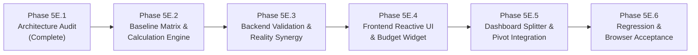

# TripNow Phase 5E.1 — Deterministic Budget Intelligence Architecture Audit Report

**Audit Status:** Complete — Comprehensive READ-ONLY Architecture Audit  
**Date:** November 1, 2026  
**Role:** Senior Travel-Tech Product Architect, Financial Calculation Engineer, React UX Engineer & Node.js Backend Architect  
**Project:** TripNow AI Travel Planner  

---

## 1. Executive Summary

TripNow provides automated travel planning combining Google Gemini generative AI (`@google/genai`), MongoDB Atlas persistence, and a responsive React frontend. Across Phases 1 through 5D, TripNow implemented security hardening, structured itinerary models, optimistic concurrency, activity locking, adaptive pivots, fix-day rebalancing, and canonical activity metadata (`activityType`, `durationMinutes`, `travelMode`, `intensity`).

As TripNow prepares for **Phase 5E (Budget Intelligence & Financial Realism)**, this audit investigates the current state of budget representation, pricing heuristics, and cost estimation across the application. 

### Key Findings
1. **Budget Semantics Are Implicit and Unformatted:** `Booking.budget` is stored as an unconstrained `String` (e.g., `"15000"`, `"₹25,000"`, `"$2,000"`). It represents the **total trip budget for the entire travel party across the full trip duration**, but this semantic contract is nowhere explicitly declared in database schemas or API validation rules.
2. **AI-Dependent Budget Breakdowns:** The current `budgetBreakdown` (`accommodation`, `foodPerDay`, `transport`, `activities`, `total`) is generated purely via Google Gemini LLM prompts. Modifying the budget currently requires either an expensive Gemini re-generation call (~2–5 seconds, API cost, non-deterministic output) or produces an inconsistent state where the user's updated budget diverges completely from the persisted itinerary breakdown.
3. **Existing Reality Engine Budget Capabilities:** The backend already houses a robust budget parsing and feasibility sub-engine (`backend/services/realityEngine/budgetEngine.js`) featuring currency detection, cost string parsing, currency mismatch defense, and activity overrun scoring. However, this engine only evaluates feasibility *after* generation or on explicit trip save; it is not exposed as a real-time reactive calculation utility for client-side editing.
4. **Isolated Dashboard Cost Splitter:** `frontend/src/pages/Dashboard.jsx` contains a client-side `CostSplitterModal` that divides trip budget by traveler count and applies fixed, hardcoded category percentages (30% Transport, 35% Accommodation, 20% Food, 10% Activities, 5% Misc). It completely ignores trip duration (days) and destination cost variations.

### Core Architecture Recommendation
Implement a **pure, zero-dependency, deterministic budget calculation engine** that runs locally in < 1ms on both client and server. The engine maps destinations to deterministic baseline cost tiers, calculates per-person and group daily expenses, computes sufficiency ratios and surplus/shortfall amounts, and generates instant actionable warnings—**without triggering a single Gemini API call upon budget or party adjustments**.

---

## 2. Existing Budget Data Contract

### 2.1 Database & Mongoose Model (`backend/models/Booking.js`)
The `Booking` model persists trip and budget data in MongoDB Atlas:

```javascript
// backend/models/Booking.js (Excerpt)
const bookingSchema = new mongoose.Schema(
  {
    user:        { type: mongoose.Schema.Types.ObjectId, ref: "User", default: null, index: true },
    destination: { type: String, required: [true, "Destination is required"], trim: true },
    guests:      { type: Number, required: [true, "Number of guests is required"], min: [1, "..."], validate: Number.isInteger },
    checkin:     { type: Date, required: [true, "Check-in date is required"] },
    checkout:    { type: Date, required: [true, "Check-out date is required"] },
    budget:      { type: String, default: null }, // Freeform string (e.g. "15000", "₹25,000")
    fullName:    { type: String, trim: true },
    email:       { type: String, trim: true },
    phone:       { type: String, trim: true },
    notes:       { type: String, default: null },
    dayCount:    { type: Number, default: 0 },
    tripData:    { type: mongoose.Schema.Types.Mixed, default: null },
    aiPlan:      { type: mongoose.Schema.Types.Mixed, default: null }, // Parsed JSON itinerary or string
    realityScore:{ type: mongoose.Schema.Types.Mixed, default: null },
    coverImage:  { type: String, default: null },
    isShared:    { type: Boolean, default: false, index: true },
  },
  { timestamps: true }
);
```

**Contract Observations:**
- `budget`: Nullable string. No schema-level regex or numeric validation. Can contain symbols (`₹`, `$`, `€`), commas, or plain numeric digits.
- `guests`: Integer $\ge 1$. Represents party size.
- `dayCount`: Integer, default 0. Often unpopulated or computed dynamically from `checkin` and `checkout`.
- `aiPlan`: Stores the full structured itinerary generated by Gemini and normalized by `itineraryNormalizer.js`.

---

### 2.2 Gemini AI Schema & Itinerary Breakdown (`backend/services/aiService.js`)
In `backend/services/aiService.js`, Gemini is instructed with a strict JSON schema:

```javascript
// backend/services/aiService.js (Excerpt)
const itinerarySchema = {
  type: Type.OBJECT,
  properties: {
    destination: { type: Type.STRING },
    days: {
      type: Type.ARRAY,
      items: {
        type: Type.OBJECT,
        properties: {
          day: { type: Type.INTEGER },
          title: { type: Type.STRING },
          morning: { type: Type.STRING },
          afternoon: { type: Type.STRING },
          evening: { type: Type.STRING },
          food: { type: Type.ARRAY, items: { type: Type.STRING } },
          activities: {
            type: Type.ARRAY,
            items: {
              type: Type.OBJECT,
              properties: {
                period: { type: Type.STRING, enum: ["morning", "afternoon", "evening"] },
                title: { type: Type.STRING },
                description: { type: Type.STRING },
                activityType: { type: Type.STRING, enum: ALLOWED_ACTIVITY_TYPES },
                durationMinutes: { type: Type.INTEGER },
                travelMode: { type: Type.STRING, enum: ALLOWED_TRAVEL_MODES },
                intensity: { type: Type.STRING, enum: ALLOWED_INTENSITIES },
              },
              required: ["period", "title", "description"],
            },
          },
        },
        required: ["day", "title", "morning", "afternoon", "evening", "food"],
      },
    },
    mustEat: { type: Type.ARRAY, items: { type: Type.STRING } },
    budgetBreakdown: {
      type: Type.OBJECT,
      properties: {
        accommodation: { type: Type.STRING },
        foodPerDay:    { type: Type.STRING },
        transport:      { type: Type.STRING },
        activities:     { type: Type.STRING },
        total:          { type: Type.STRING },
      },
      required: ["accommodation", "foodPerDay", "transport", "activities", "total"],
    },
    travelTips: { type: Type.ARRAY, items: { type: Type.STRING } },
    whereToStay: {
      type: Type.OBJECT,
      properties: {
        budget:   { type: Type.STRING },
        midRange: { type: Type.STRING },
      },
      required: ["budget", "midRange"],
    },
    bestTimeToVisit: { type: Type.STRING },
  },
  required: [
    "destination",
    "days",
    "mustEat",
    "budgetBreakdown",
    "travelTips",
    "whereToStay",
    "bestTimeToVisit",
  ],
};
```

**Prompt Construction In `aiService.js`:**
```javascript
const buildItineraryPrompt = ({ prompt, destination, budget, startDate, endDate }) => {
  if (prompt) return prompt;
  const baseDetails = `Destination: ${destination}
Dates: ${startDate || "Upcoming"} to ${endDate || "Flexible"}
Budget: ₹${budget || "Standard"}`;
  ...
};
```
*Notice:* The prompt hardcodes `Budget: ₹${budget || "Standard"}`. Even if the user intended USD or EUR, the prompt unconditionally prefixes `₹`.

---

### 2.3 Activity-Level Cost Fields & Itinerary Normalizer (`backend/utils/itineraryNormalizer.js`)
In the Gemini `itinerarySchema`, `activity.cost` is **not** defined in the initial generation schema. Instead, `backend/utils/itineraryNormalizer.js` applies backward-compatible defaults:

```javascript
// backend/utils/itineraryNormalizer.js (Excerpt)
cost: act.cost || act.costEstimate || "Moderate",
```
When synthesizing structured activities from legacy text blocks:
```javascript
cost: "Moderate",
```

However, in Pivot and Fix Day services (`backend/services/pivotService.js` and `backend/services/fixDayService.js`), `cost` **is** a required string field in `PIVOT_CANDIDATE_SCHEMA` and `FIX_DAY_CANDIDATE_SCHEMA`:
```javascript
cost: { type: Type.STRING } // e.g. "Free", "₹500", "Moderate"
```

---

### 2.4 Existing Reality Engine Budget Module (`backend/services/realityEngine/budgetEngine.js`)
The Reality Engine evaluates trip-level budget realism during `evaluateTripReality`:

1. **`detectCurrency(text)`**: Identifies `INR` (`₹`, `inr`, `rupee`, `rs`), `USD` (`$`, `usd`, `dollar`), `EUR` (`€`, `eur`, `euro`), `GBP` (`£`, `gbp`, `pound`), `JPY` (`¥`, `jpy`, `yen`). Defaults to `null`.
2. **`parseCostString(costStr, expectedCurrency)`**:
   - `Free` variants (`"free"`, `"₹0"`, `"$0"`) $\rightarrow$ `{ amount: 0, isFree: true }`.
   - Range (`"₹100 - ₹200"`) $\rightarrow$ Midpoint (`150`).
   - Exact numeric (`"₹500"`, `"250 INR"`) $\rightarrow$ Numeric amount (`500`, `250`).
   - Currency mismatch defense: If `detectedCurrency !== expectedCurrency`, returns `currencyMismatch: true` and excludes amount from calculation to prevent silently comparing `$25` to `₹25`.
   - Descriptive prose (`"Moderate"`, `"Varies"`, `"TBD"`) $\rightarrow$ `{ amount: null, isUnspecified: true }`.
3. **`parseNumericBudget(rawBudget)`**: Extracts numeric float via `/(\d+)/` after stripping commas.
4. **`evaluateTripBudget({ days, rawBudget, budgetBreakdown })`**:
   - Computes `budgetCeiling` (prefers `rawBudget`, falls back to `budgetBreakdown.total`).
   - Allocates activity allowance: prefers `budgetBreakdown.activities`, falls back to $40\%$ of `budgetCeiling`.
   - Compares `totalKnownActivityCost` to activity allowance:
     - Ratio $\le 0.85 \rightarrow$ Sub-score $100$
     - Ratio $0.85$ to $1.0 \rightarrow$ Sub-score $100 \dots 80$
     - Ratio $1.0$ to $1.25 \rightarrow$ Over-budget, Sub-score $80 \dots 40$ (Flags `iss-budget-overrun`)
     - Ratio $> 1.25 \rightarrow$ Severe over-budget, Sub-score $40 \dots 0$ (Flags `iss-budget-overrun-severe`)
     - If budget unspecified $\rightarrow$ Defaults to sub-score $85$.

---

### 2.5 Frontend Budget Inputs & Modals

| File | Component / Form | Role & Semantics | Data Type | Default Value |
| :--- | :--- | :--- | :--- | :--- |
| `frontend/src/pages/Home.jsx` | Hero search form | User enters trip parameters | `number` input | `""` (QuickPlan uses `"15000"`) |
| `frontend/src/utils/destinations.js` | Featured Destination Cards | Pre-configured package prices | `string` (e.g. `"₹22,000"`) | Set per card (10k to 40k) |
| `frontend/src/components/DestinationCard.jsx` | `handleBooking` | Passes `destination.price` as `state.budget` | `string` | e.g. `"₹22,000"` |
| `frontend/src/pages/PlanTrip.jsx` | Sidebar & `activeTab === "Budget"` | Displays `₹{budget}` and Gemini `budgetBreakdown` | `string` | From `location.state` or `booking.budget` |
| `frontend/src/pages/Booking.jsx` | Trip confirmation form | Displays `Total Budget: ₹{budget}` | `string` | From `location.state.budget` |
| `frontend/src/pages/Dashboard.jsx` | Edit Trip Modal | Input for editing `Booking.budget` | `string` input | Current `trip.budget` |
| `frontend/src/pages/Dashboard.jsx` | `CostSplitterModal` | Divides budget by `people` with fixed category percentages | `number` input | Current `trip.budget` |

---

## 3. Current Budget Semantics & Ambiguities

### 3.1 Verified Budget Semantics
From source-code inspection:
1. **Total Trip Budget:** The budget represents the **total expenditure for the entire trip**, not a daily allowance. This is confirmed by `Booking.jsx` (`Total Budget: ₹{budget}`), `Dashboard.jsx:CostSplitterModal` (`grand / people`), and `realityEngine/budgetEngine.js` (`budgetCeiling`).
2. **Entire Group / Travel Party:** The budget is intended to cover the whole party (`guests`), as evidenced by `Booking.jsx` where travelers is set alongside the total budget and `Dashboard.jsx` where `grand` is divided by `people`.
3. **Primary Currency:** The platform defaults implicitly to Indian Rupees (`INR` / `₹`). Form labels specify `Budget (₹)`, prompts hardcode `Budget: ₹...`, and formatting utilities use `.toLocaleString("en-IN")`. However, the reality engine supports parsing `USD`, `EUR`, `GBP`, and `JPY`.
4. **Expense Coverage:**
   - **Included:** Accommodation, local transportation (cabs, metro, autos), food/dining, and activities/entrance fees.
   - **Excluded:** Intercity / international flights and major long-distance rail are excluded. In `Dashboard.jsx:CostSplitterModal`, a separate `"Extras (₹)"` field exists for unbudgeted add-ons.
5. **Activity Costs:** Mixed. Gemini does not return numeric activity costs in initial generation (normalizer assigns `"Moderate"`). Pivot and Fix Day generate string costs (e.g., `"Free"`, `"₹500"`).

### 3.2 Current Semantic Ambiguities & Architectural Gaps

```
┌─────────────────────────────────┬─────────────────────────────────────────────────────────┬──────────────────────────────────────────────────────┐
│ Area                            │ Current Problem / Ambiguity                             │ Architectural Consequence                            │
├─────────────────────────────────┼─────────────────────────────────────────────────────────┼──────────────────────────────────────────────────────┤
│ 1. Party Size in Planning       │ Home.jsx search form lacks a "Guests" input; defaults   │ Initial AI generation plans for 1 person by default;  │
│                                 │ to 1 guest in aiService.js.                             │ user only specifies party size later in Booking.jsx. │
├─────────────────────────────────┼─────────────────────────────────────────────────────────┼──────────────────────────────────────────────────────┤
│ 2. Trip Duration Coupling       │ If user alters trip dates (duration changes from        │ A 3-day budget of ₹30,000 becomes grossly inadequate │
│                                 │ 3 to 10 days), budget remains static without warning.   │ for 10 days without user awareness.                  │
├─────────────────────────────────┼─────────────────────────────────────────────────────────┼──────────────────────────────────────────────────────┤
│ 3. LLM Dependence for Recalc    │ aiPlan.budgetBreakdown is fixed JSON from Gemini. User   │ Modifying budget in Dashboard or PlanTrip leaves     │
│                                 │ cannot recalculate category splits without re-prompt.   │ aiPlan.budgetBreakdown permanently stale.            │
├─────────────────────────────────┼─────────────────────────────────────────────────────────┼──────────────────────────────────────────────────────┤
│ 4. Fixed Percentages in UI      │ CostSplitterModal uses fixed 30/35/20/10/5 % splits     │ In high-cost metro vs. budget hill station, hotel   │
│                                 │ regardless of destination or budget scale.              │ and transit proportions differ significantly.        │
├─────────────────────────────────┼─────────────────────────────────────────────────────────┼──────────────────────────────────────────────────────┤
│ 5. Non-Numeric Activity Costs   │ Normalizer defaults activities to "Moderate".           │ Reality Engine reports "Most activities have non-    │
│                                 │                                                         │ numeric cost indicators; exact feasibility skipped". │
├─────────────────────────────────┼─────────────────────────────────────────────────────────┼──────────────────────────────────────────────────────┤
│ 6. No Real-Time Pre-Check       │ User submits budget blind; receives feedback only after │ User must wait ~5s for Gemini generation before      │
│                                 │ generation completes.                                   │ learning their budget was unrealistic.               │
└─────────────────────────────────┴─────────────────────────────────────────────────────────┴──────────────────────────────────────────────────────┘
```

---

## 4. End-to-End Budget Data-Flow Diagram

The following diagram maps the lifecycle of budget data from entry to presentation:

```
[ User Input: Home.jsx / DestinationCard.jsx ]
   │
   ├─► Home.jsx: form.budget (e.g. "15000")
   └─► DestinationCard.jsx: destination.price (e.g. "₹22,000")
         │
         ▼
[ React Router Navigation: state: { destination, budget, checkin, checkout } ]
         │
         ▼
[ PlanTrip.jsx: Initialization & Generation Trigger ]
   │
   ├─► Client state: budget (string)
   └─► HTTP POST /api/ai { destination, budget, startDate, endDate }
         │
         ▼
[ Backend: aiController.js -> aiService.js ]
   │
   ├─► Hardcoded prompt: "Budget: ₹${budget || 'Standard'}"
   ├─► Google Gemini API Call (gemini-2.5-flash / fallback)
   │     └─ Returns JSON with:
   │          - budgetBreakdown: { accommodation, foodPerDay, transport, activities, total }
   │          - whereToStay: { budget, midRange }
   │          - days[].activities[] (WITHOUT cost field)
   │
   ├─► itineraryNormalizer.js:
   │     └─ Assigns activity.cost = "Moderate" (since Gemini omitted it)
   │
   ├─► MongoDB Booking.create:
   │     └─ { destination, guests: 1, checkin, checkout, budget, aiPlan: JSON }
   │
   └─► Return { text, parsed, tripId } to PlanTrip.jsx
         │
         ▼
[ PlanTrip.jsx: Rendering ]
   │
   ├─► Sidebar: displays "₹" + budget
   ├─► "Budget" Tab: renders parsed.budgetBreakdown table
   └─► Reality Score Widget:
         │
         ▼
[ Reality Engine: evaluateTripReality() -> budgetEngine.js ]
   │
   ├─► Reads: Booking.budget, aiPlan.days[].activities[].cost, aiPlan.budgetBreakdown
   ├─► Detects currency: INR
   ├─► Parses numeric budget ceiling
   ├─► Evaluates activity costs against 40% cap
   └─► Produces: realityReport.subScores.budgetFeasibility (0-100)
         │
         ▼
[ Post-Generation Modifications ]
   ├─► Adaptive / Custom Pivot (pivotService.js): Gemini returns activity.cost string
   ├─► Fix Day (fixDayService.js): Gemini returns activity.cost string
   └─► Dashboard.jsx:
         ├─ Edit Trip Modal: updates Booking.budget via PUT /api/bookings/:id
         └─ CostSplitterModal: splits budget / people (fixed 30/35/20/10/5 % splits)
```

---

## 5. Proposed Destination-Tier Baseline Matrix

To evaluate budget feasibility deterministically without calling Gemini on every keystroke, destinations are categorized into four standardized economic tiers.

### 5.1 Destination Classification Rules
The classification is resolved via normalized keyword matching against the destination string (case-insensitive):

1. **Tier 1 — High-Cost Metros & Global Capitals (`tier_metro`):**
   - *Domestic:* Mumbai, Delhi, New Delhi, Bengaluru, Bangalore, Chennai, Kolkata, Hyderabad, Gurgaon, Noida.
   - *International Metros:* Tokyo, London, Paris, New York, Singapore, Dubai, Hong Kong, Sydney, San Francisco, Amsterdam.
2. **Tier 2 — Beach, Island & Luxury Resorts (`tier_resort`):**
   - *Domestic:* Goa, Andaman, Nicobar, Havelock, Lakshadweep, Puducherry, Pondicherry, Alibaug, Daman, Diu.
   - *International Resorts:* Bali, Phuket, Maldives, Koh Samui, Mauritius, Cancun, Hawaii, Santorini, Fiji.
3. **Tier 3 — Regional Heritage, Culture & Budget Hills (`tier_regional_hills`):**
   - *Domestic:* Manali, Shimla, Rishikesh, Jaipur, Udaipur, Darjeeling, Varanasi, Dharamshala, McLeodGanj, Ooty, Munnar, Kodaikanal, Nainital, Mussoorie, Kasol, Pushkar, Hampi, Gokarna, Agra, Amritsar, Jodhpur, Jaisalmer.
   - *Regional:* Kathmandu, Pokhara, Bhutan, Sri Lanka (budget circuits).
4. **Tier 4 — Standard Domestic & Emerging Tier-2 Destinations (`tier_standard_fallback`):**
   - Default fallback tier for any unclassified or unrecognized destination (e.g. Pune, Chandigarh, Lucknow, Indore, Ahmedabad, Kochi, Bhopal).

---

### 5.2 Deterministic Baseline Daily Cost Matrix (Per Person / Day in INR)

> [!NOTE]
> The figures below represent **daily per-person baseline costs in INR (₹)** for independent travel (excluding intercity flights). Twin sharing is assumed for accommodation calculations ($\text{Room Cost} \div 2$). These baselines serve as reference calculation anchors and are fully configurable.

```
┌─────────────────────────┬──────────────┬──────────────┬──────────────┬──────────────┐
│ Expense Category        │ Tier 1       │ Tier 2       │ Tier 3       │ Tier 4       │
│                         │ Metro        │ Resort/Beach │ Hills/Budget │ Standard/Def │
├─────────────────────────┼──────────────┼──────────────┼──────────────┼──────────────┤
│ 1. Accommodation        │              │              │              │              │
│    • Budget (Hostel/PG) │ ₹800         │ ₹700         │ ₹500         │ ₹600         │
│    • Standard (3-Star)  │ ₹2,200       │ ₹2,000       │ ₹1,400       │ ₹1,600       │
│    • Premium (4/5-Star) │ ₹5,500       │ ₹5,000       │ ₹3,500       │ ₹4,000       │
├─────────────────────────┼──────────────┼──────────────┼──────────────┼──────────────┤
│ 2. Food & Dining        │              │              │              │              │
│    • Budget (Local/Caf) │ ₹600         │ ₹500         │ ₹350         │ ₹400         │
│    • Standard (Mid-rest)│ ₹1,400       │ ₹1,200       │ ₹800         │ ₹1,000       │
│    • Premium (Fine-din) │ ₹3,200       │ ₹2,800       │ ₹1,800       │ ₹2,200       │
├─────────────────────────┼──────────────┼──────────────┼──────────────┼──────────────┤
│ 3. Local Transportation │              │              │              │              │
│    • Budget (Metro/Bus) │ ₹250         │ ₹200 (Scoot) │ ₹150         │ ₹150         │
│    • Standard (Cabs/Aut)│ ₹700         │ ₹600 (Cab/Sco│ ₹400 (Shared)│ ₹500 (Cab)   │
│    • Premium (Chauffeur)│ ₹1,800       │ ₹1,500       │ ₹1,200       │ ₹1,400       │
├─────────────────────────┼──────────────┼──────────────┼──────────────┼──────────────┤
│ 4. Activities & Sights  │              │              │              │              │
│    • Budget (Free/Pub)  │ ₹200         │ ₹250         │ ₹150         │ ₹150         │
│    • Standard (Tickets) │ ₹600         │ ₹800 (Sports)│ ₹400         │ ₹500         │
│    • Premium (Guided/VIP│ ₹1,800       │ ₹2,200       │ ₹1,200       │ ₹1,500       │
├─────────────────────────┼──────────────┼──────────────┼──────────────┼──────────────┤
│ 5. Miscellaneous Buffer │              │              │              │              │
│    • Budget             │ ₹150         │ ₹150         │ ₹100         │ ₹100         │
│    • Standard           │ ₹400         │ ₹400         │ ₹250         │ ₹300         │
│    • Premium            │ ₹1,000       │ ₹1,000       │ ₹600         │ ₹800         │
├─────────────────────────┼──────────────┼──────────────┼──────────────┼──────────────┤
│ TOTAL PER-PERSON / DAY: │              │              │              │              │
│    • MINIMUM (Budget)   │ ₹2,000 / day │ ₹1,800 / day │ ₹1,250 / day │ ₹1,400 / day │
│    • STANDARD (Moderate)│ ₹5,300 / day │ ₹5,000 / day │ ₹3,250 / day │ ₹3,900 / day │
│    • PREMIUM (Comfort)  │ ₹13,300/ day │ ₹12,500/ day │ ₹8,300 / day │ ₹9,900 / day │
└─────────────────────────┴──────────────┴──────────────┴──────────────┴──────────────┘
```

---

### 5.3 Currency Conversion & Normalization Anchors
While TripNow defaults to INR (`₹`), international trips or international users may provide budgets in `USD`, `EUR`, `GBP`, or `JPY`.

To maintain deterministic repeatability without depending on external live exchange rate APIs (which could fail or introduce latency during client keystrokes), the engine incorporates configurable baseline conversion anchors:

| Currency | Symbol | Anchor Rate (to INR) | Minimum Daily Baseline (Tier 1 Metro) | Standard Daily Baseline (Tier 1 Metro) |
| :--- | :--- | :--- | :--- | :--- |
| **INR** | ₹ | 1.0 | ₹2,000 | ₹5,300 |
| **USD** | $ | 85.0 | $24 | $62 |
| **EUR** | € | 90.0 | €22 | €59 |
| **GBP** | £ | 108.0 | £19 | £49 |
| **JPY** | ¥ | 0.55 | ¥3,600 | ¥9,600 |

*Conversion Policy:* When an input uses a recognized foreign currency, the engine calculates baselines converted to that currency, preserving the user's unit of account.

---

## 6. Proposed Budget Classification Formulas

### 6.1 Core Input Contract
The calculation function receives an explicit input object:
$$\text{Input} = \{ \text{budget}, \text{days}, \text{guests}, \text{destination}, \text{currency} \}$$

Validation & Sanitization:
- $\text{days} = \max(1, \text{Math.round}(\text{days}))$;
- $\text{guests} = \max(1, \text{Math.round}(\text{guests}))$;
- $\text{totalBudget} = \text{parseNumericBudget}(\text{budget}) \ge 0$;

---

### 6.2 Mathematical Formulas

1. **Effective Total Days ($D$):**
   $$D = \max(1, \text{days})$$

2. **Total Party Size ($G$):**
   $$G = \max(1, \text{guests})$$

3. **Per-Person Daily Budget ($B_{\text{ppd}}$):**
   $$B_{\text{ppd}} = \frac{\text{totalBudget}}{G \times D}$$

4. **Group Daily Budget ($B_{\text{gpd}}$):**
   $$B_{\text{gpd}} = \frac{\text{totalBudget}}{D} = B_{\text{ppd}} \times G$$

5. **Estimated Trip Baseline Cost ($C_{\text{std}}$ and $C_{\text{min}}$):**
   $$C_{\text{min}} = \text{Tier}_{\text{min}} \times G \times D$$
   $$C_{\text{std}} = \text{Tier}_{\text{std}} \times G \times D$$
   $$C_{\text{prem}} = \text{Tier}_{\text{prem}} \times G \times D$$

6. **Budget Sufficiency Ratio ($R_{\text{suff}}$):**
   $$R_{\text{suff}} = \frac{B_{\text{ppd}}}{\text{Tier}_{\text{std}}}$$
   - $R_{\text{suff}} < 0.65$: Budget is critically low (below minimum backpacker threshold).
   - $0.65 \le R_{\text{suff}} < 1.0$: Budget covers minimum/backpacker expenses but is tight for standard hotels/dining.
   - $1.0 \le R_{\text{suff}} \le 2.0$: Budget comfortably covers standard accommodations, dining, and transit.
   - $R_{\text{suff}} > 2.0$: Budget supports premium/luxury accommodations and private activities.

7. **Shortfall or Surplus ($\Delta$):**
   $$\Delta_{\text{std}} = \text{totalBudget} - C_{\text{std}}$$
   $$\Delta_{\text{min}} = \text{totalBudget} - C_{\text{min}}$$
   - If $\Delta_{\text{min}} < 0$: Shortfall against bare minimum.
   - If $\Delta_{\text{min}} \ge 0$ and $\Delta_{\text{std}} < 0$: Surplus over minimum, but shortfall against standard travel.
   - If $\Delta_{\text{std}} \ge 0$: Surplus for standard travel.

---

### 6.3 Budget Tier Classification

The classification determines the user's travel comfort bracket:

| Classification | Condition | Traveler Experience |
| :--- | :--- | :--- |
| **`low`** (Budget / Backpacker) | $B_{\text{ppd}} < \text{Tier}_{\text{std}} \times 0.75$ | Hostels/homestays, public transit, street/local food, free sightseeing. |
| **`moderate`** (Standard / Balanced) | $\text{Tier}_{\text{std}} \times 0.75 \le B_{\text{ppd}} < \text{Tier}_{\text{std}} \times 1.50$ | 3-star hotels/Airbnbs, app cabs/autos, casual dining, ticketed monuments. |
| **`high`** (Comfort / Premium) | $B_{\text{ppd}} \ge \text{Tier}_{\text{std}} \times 1.50$ | 4/5-star resorts, private chauffeur/cabs, fine dining, private tours. |

---

## 7. Budget Warning Logic

The warning engine evaluates concrete mathematical conditions and returns structured warning objects:
```typescript
interface BudgetWarning {
  code: string;
  severity: "info" | "success" | "warning" | "error";
  title: string;
  message: string;
  suggestedAction?: string;
}
```

### 7.1 Warning Rules Matrix

```
┌────────────────────────────────┬───────────────────────────────┬──────────┬────────────────────────────────────────────────────────┐
│ Code                           │ Trigger Condition             │ Severity │ Message & Practical Guidance                           │
├────────────────────────────────┼───────────────────────────────┼──────────┼────────────────────────────────────────────────────────┤
│ `BUDGET_MISSING_OR_ZERO`       │ budget == null || budget <= 0 │ warning  │ "No budget entered. Estimated standard trip cost is     │
│                                │                               │          │  ₹[C_std]. Enter a budget to verify feasibility."      │
├────────────────────────────────┼───────────────────────────────┼──────────┼────────────────────────────────────────────────────────┤
│ `BUDGET_BELOW_MINIMUM`         │ B_ppd < Tier_min              │ error    │ "Your daily budget (₹[B_ppd]/person) is below the      │
│                                │                               │          │  estimated minimum (₹[Tier_min]) for [Destination]."   │
│                                │                               │          │  Guidance: Consider ₹[C_min] minimum total or reduce   │
│                                │                               │          │  duration to [D_adj] days.                             │
├────────────────────────────────┼───────────────────────────────┼──────────┼────────────────────────────────────────────────────────┤
│ `BUDGET_TIGHT`                 │ Tier_min <= B_ppd <           │ warning  │ "Budget is tight for [Destination]. Hostels and local  │
│                                │ Tier_min * 1.25               │          │  transit are recommended. Minimal buffer for extras."  │
├────────────────────────────────┼───────────────────────────────┼──────────┼────────────────────────────────────────────────────────┤
│ `BUDGET_ADEQUATE_STANDARD`     │ Tier_std * 0.85 <= B_ppd <=   │ success  │ "Healthy standard budget. Covers comfortable 3-star    │
│                                │ Tier_std * 1.50               │          │  stays, dining, and main attractions."                 │
├────────────────────────────────┼───────────────────────────────┼──────────┼────────────────────────────────────────────────────────┤
│ `BUDGET_PREMIUM`               │ B_ppd > Tier_std * 1.50       │ success  │ "Generous budget. Allows premium 4-5 star resorts,     │
│                                │                               │          │  private cabs, and fine dining."                       │
├────────────────────────────────┼───────────────────────────────┼──────────┼────────────────────────────────────────────────────────┤
│ `DESTINATION_TIER_UNKNOWN`     │ Destination not recognized    │ info     │ "Estimated using national standard travel baselines.   │
│                                │ in Tier 1, 2, or 3            │          │  Local prices may vary slightly."                      │
├────────────────────────────────┼───────────────────────────────┼──────────┼────────────────────────────────────────────────────────┤
│ `CURRENCY_MISMATCH`            │ Currency code in budget       │ warning  │ "Budget currency ([detected]) differs from trip base   │
│                                │ conflicts with destination    │          │  currency. Calculations normalized to [detected]."     │
└────────────────────────────────┴───────────────────────────────┴──────────┴────────────────────────────────────────────────────────┘
```

> [!IMPORTANT]
> The engine will **never** claim an itinerary is "impossible". It classifies trips as `tight`, `budget/backpacker`, `standard`, or `premium`, providing constructive suggestions (e.g. suggesting realistic accommodation types or duration trade-offs).

---

## 8. Currency & Precision Rounding Strategy

### 8.1 Precision & Floating-Point Protection
Floating-point arithmetic in JavaScript can generate unsightly artifacts (e.g. `14999.999999999998`). 

The calculation engine enforces integer precision across all displayed and persisted monetary values:
1. **Intermediate Calculations:** Floating-point operations maintain IEEE 754 precision.
2. **Display Rounding:** All user-facing amounts are rounded to the nearest integer:
   $$\text{displayAmount} = \text{Math.round}(\text{amount})$$
3. **Locale-Aware Formatting:**
   - INR (`INR`): `displayAmount.toLocaleString("en-IN")` (e.g., `₹25,000`).
   - USD (`USD`): `displayAmount.toLocaleString("en-US")` (e.g., `$1,250`).
   - EUR (`EUR`): `displayAmount.toLocaleString("de-DE")` (e.g., `€1.200`).
4. **Zero-Division Guards:**
   - If `guests <= 0`, engine enforces `guests = 1`.
   - If `days <= 0`, engine enforces `days = 1`.

---

## 9. Deterministic Calculation Architecture

To achieve zero Gemini API latency upon budget adjustments, the calculation logic is structured as a **pure, idempotent mathematical engine**.

### 9.1 Shared Calculation Contract
```typescript
interface BudgetIntelligenceInput {
  budget: string | number | null;
  days: number;
  guests: number;
  destination: string;
  currency?: string | null;
}

interface BudgetCategoryBreakdown {
  accommodation: number;
  food: number;
  transport: number;
  activities: number;
  misc: number;
  total: number;
}

interface BudgetIntelligenceResult {
  tier: "tier_metro" | "tier_resort" | "tier_regional_hills" | "tier_standard_fallback";
  tierName: string;
  currency: string;
  currencySymbol: string;
  totalBudget: number;
  perPersonDaily: number;
  groupDaily: number;
  estimatedBaseline: {
    minimum: number;
    standard: number;
    premium: number;
  };
  breakdown: BudgetCategoryBreakdown;
  category: "low" | "moderate" | "high";
  sufficiencyRatio: number;
  surplusShortfallVsStandard: number;
  surplusShortfallVsMinimum: number;
  warnings: BudgetWarning[];
}
```

### 9.2 Module Placement & Zero-Duplication Recommendation
To avoid duplicating business rules between backend validation and frontend UI:
- **Recommended Implementation:** A pure, dependency-free JavaScript module authored with standard CommonJS/ESM compatibility:
  - `backend/services/budgetIntelligence/index.js` (used by controllers, validators, and reality scoring).
  - Symmetrically mirrored or shared to `frontend/src/utils/budgetIntelligence.js`.
- Both frontend and backend share identical baseline figures, categorization boundaries, and warning messages.

---

## 10. Existing Itinerary Integration & Backward Compatibility

The introduction of deterministic budget intelligence must not break any existing feature or test suite:

1. **Mongoose `Booking` Model:** No schema migrations required. `budget` remains a `String` field. New calculated fields can be generated on the fly or stored under `realityScore` without database schema changes.
2. **Gemini Initial Generation:** `aiService.js` continues generating rich JSON itineraries. The deterministic engine provides instant feedback on the planning page *before and after* generation.
3. **`itineraryNormalizer.js`:** Preserves activity metadata and existing `cost` field values.
4. **Adaptive Pivot & Custom Pivot:** Replacement activities continue using `PIVOT_CANDIDATE_SCHEMA` with string costs.
5. **Fix Day:** Continues rebalancing schedules while preserving activity costs.
6. **Reality Score Synergy:** The Reality Engine's `budgetEngine.js` evaluates actual activity costs against the budget ceiling. The new deterministic engine complements this by assessing overall trip baseline viability.

---

## 11. UX Recommendations for PlanTrip and Dashboard

### 11.1 PlanTrip.jsx (Pre- and Post-Generation)
- **Live Budget Intelligence Widget:** Placed in the sidebar and under the "Budget" tab.
- **Interactive Budget & Guest Controls:** Allows the user to adjust budget, traveler count, and trip duration via direct inputs or steppers (`+`/`-`).
- **Instant Reactive Updates:** On every keystroke, the widget recalculates:
  - Per-person daily budget badge (`₹1,500/day/person`).
  - Budget status chip (`Low / Backpacker`, `Standard / Comfortable`, `High / Luxury`).
  - Dynamic Sufficiency Gauge (visual progress bar with green/amber/rose color indicators).
  - Contextual warning or recommendation alert.
- **Zero API Call Guarantee:** Keystrokes run entirely in React local state (< 1ms), requiring zero network requests and zero Gemini tokens.

### 11.2 Dashboard.jsx
- **Enhanced Cost Splitter Modal:** Upgrade `CostSplitterModal` to replace static 30/35/20/10/5 % splits with destination-tier-aware category allocations.
- **Trip Card Budget Badges:** Display budget comfort chip (`Standard`, `Budget`, `Premium`) directly on dashboard trip cards.

---

## 12. Testing Strategy

The test plan covers 15 distinct verification domains to ensure mathematical accuracy and regression freedom:

```
┌────┬────────────────────────────────────┬───────────────────────────────────────────────────────────────┐
│ #  │ Test Domain                        │ Verification Objective                                        │
├────┼────────────────────────────────────┼───────────────────────────────────────────────────────────────┤
│ 1  │ Destination Tier Classification   │ Verify exact match, case insensitivity, substring matching    │
│    │                                    │ (e.g. "North Goa" -> tier_resort; "Old Delhi" -> tier_metro).  │
├────┼────────────────────────────────────┼───────────────────────────────────────────────────────────────┤
│ 2  │ Low/Moderate/High Categorization   │ Confirm boundary values correctly transition categories.      │
├────┼────────────────────────────────────┼───────────────────────────────────────────────────────────────┤
│ 3  │ Per-Person Daily Math              │ Validate totalBudget / (guests * days) across combinations.   │
├────┼────────────────────────────────────┼───────────────────────────────────────────────────────────────┤
│ 4  │ Group Daily Math                   │ Validate totalBudget / days across solo & group party sizes.  │
├────┼────────────────────────────────────┼───────────────────────────────────────────────────────────────┤
│ 5  │ Daily vs Total Scalability         │ Verify linear scaling when days or guests scale by 2x, 5x.    │
├────┼────────────────────────────────────┼───────────────────────────────────────────────────────────────┤
│ 6  │ Duration Changes                   │ Confirm 1-day, 3-day weekend, 7-day, and 14-day calculations. │
├────┼────────────────────────────────────┼───────────────────────────────────────────────────────────────┤
│ 7  │ Traveler-Count Changes             │ Test solo (1), couple (2), family (4), large group (10).      │
├────┼────────────────────────────────────┼───────────────────────────────────────────────────────────────┤
│ 8  │ Currency Handling                  │ Test INR, USD, EUR, GBP, JPY currency symbol and rate parsing. │
├────┼────────────────────────────────────┼───────────────────────────────────────────────────────────────┤
│ 9  │ Invalid / Missing Inputs           │ Handle null, undefined, "", negative, NaN, 0 without crash.   │
├────┼────────────────────────────────────┼───────────────────────────────────────────────────────────────┤
│ 10 │ Unknown Destination Tiers          │ Ensure fallback to Tier 4 with informative warning.           │
├────┼────────────────────────────────────┼───────────────────────────────────────────────────────────────┤
│ 11 │ Budget Shortfall / Surplus         │ Confirm accurate positive/negative delta against baselines.   │
├────┼────────────────────────────────────┼───────────────────────────────────────────────────────────────┤
│ 12 │ Deterministic Repeatability        │ 1,000 iterations with same inputs produce byte-identical JSON.│
├────┼────────────────────────────────────┼───────────────────────────────────────────────────────────────┤
│ 13 │ Existing Itinerary Compatibility   │ Existing Booking documents with string budgets load safely.   │
├────┼────────────────────────────────────┼───────────────────────────────────────────────────────────────┤
│ 14 │ Pivot & Fix Day Compatibility      │ Rebalancing and swapping activities maintain cost integrity.  │
├────┼────────────────────────────────────┼───────────────────────────────────────────────────────────────┤
│ 15 │ Zero Gemini Calls on Budget Edit   │ Mock network spy confirms zero AI SDK or HTTP calls on edit.  │
└────┴────────────────────────────────────┴───────────────────────────────────────────────────────────────┘
```

---

## 13. Implementation Roadmap (Phases 5E.2 – 5E.6)



### Phase 5E.2 — Baseline Matrix & Calculation Engine
- **Files to Create/Edit:**
  - `backend/services/budgetIntelligence/destinationTiers.js`
  - `backend/services/budgetIntelligence/baselineMatrix.js`
  - `backend/services/budgetIntelligence/budgetEngine.js`
  - Symmetrical client export: `frontend/src/utils/budgetIntelligence.js`
  - Unit tests: `backend/tests/budgetIntelligenceEngine.test.js`
- **Risks:** Inaccurate boundary conditions; currency conversion precision errors.
- **Acceptance Criteria:** 100% test pass on tier classification, category assignment, and shortfall/surplus calculations.

### Phase 5E.3 — Backend Integration & Validation
- **Files to Create/Edit:**
  - `backend/controllers/bookingController.js` (enrich trip responses with budget intelligence metrics).
  - `backend/services/realityEngine/budgetEngine.js` (cross-check baseline feasibility with activity costs).
  - Tests: `backend/tests/bookingBudgetEnrichment.test.js`.
- **Risks:** Accidental modification of existing Reality Score calculations.
- **Acceptance Criteria:** All existing 455 backend tests remain 100% green; budget intelligence metrics attached non-destructively.

### Phase 5E.4 — Frontend Budget Intelligence UI
- **Files to Create/Edit:**
  - `frontend/src/components/BudgetIntelligenceWidget.jsx`
  - `frontend/src/pages/PlanTrip.jsx`
  - `frontend/src/pages/Home.jsx` (add party size / guests input).
- **Risks:** React re-render performance on keystroke; layout shifts on mobile.
- **Acceptance Criteria:** Budget, days, and guest changes update instantaneously (< 16ms / 60fps) with zero Gemini requests.

### Phase 5E.5 — Dashboard & Itinerary Integration
- **Files to Create/Edit:**
  - `frontend/src/pages/Dashboard.jsx` (upgrade `CostSplitterModal` and `TripCard` chips).
  - `frontend/src/utils/pdf.js` (include budget category and sufficiency summary in exports).
- **Risks:** Stale trip data in dashboard modals.
- **Acceptance Criteria:** Cost splitter reflects destination-specific category breakdowns; PDF export retains full metadata consistency.

### Phase 5E.6 — Regression & Browser Acceptance
- **Files to Create/Edit:**
  - Acceptance script: `scripts/verifyPhase5e6Acceptance.js`
  - Full suite regression test execution.
- **Risks:** Headless Chrome flakiness in CDP automation.
- **Acceptance Criteria:** 100% pass across all 28+ backend test suites; Vite production build passes with 0 warnings; automated browser acceptance passes all interactive budget scenarios.

---

## 14. Risks and Unresolved Decisions Requiring Owner Approval

The following specific design decisions require explicit owner review before proceeding to implementation in Phase 5E.2:

1. **Guest Count on Home Page Form:**
   - *Current State:* `Home.jsx` only prompts for Destination, Check-in, Check-out, and Budget. Traveler count is deferred until `Booking.jsx`.
   - *Proposed Enhancement:* Add a "Travelers" input (default `1` or `2`) to `Home.jsx` so that per-person daily budget intelligence is immediately accurate during the initial planning step.
   - *Question for Owner:* Should `Home.jsx` include the "Travelers" field directly on the hero search bar?
2. **Deterministic Baseline Anchor Values:**
   - *Current State:* No official baseline figures exist in the repository outside of featured card prices in `frontend/src/utils/destinations.js`.
   - *Proposed Baseline:* Tier 1 Metro (₹2,000 min / ₹5,300 std), Tier 2 Resort (₹1,800 min / ₹5,000 std), Tier 3 Hills (₹1,250 min / ₹3,250 std), Tier 4 Default (₹1,400 min / ₹3,900 std).
   - *Question for Owner:* Are these proposed daily per-person baseline brackets acceptable as initial configurable defaults?
3. **Flight / Intercity Transit Exclusion:**
   - *Current State:* Budget excludes flights, but users may mistakenly believe a ₹15,000 budget for Paris covers international airfare.
   - *Proposed Rule:* Add an explicit UI note: *"Estimates exclude long-distance flights and intercity trains."*
   - *Question for Owner:* Should international airfare remain excluded from the standard budget calculation?
4. **Code Sharing Strategy:**
   - *Option A:* Symmetrical pure utility files in `backend/services/budgetIntelligence/` and `frontend/src/utils/budgetIntelligence.js`.
   - *Option B:* Single shared package or root utility imported by both.
   - *Recommendation:* Option A provides clean decoupling, zero build pipeline overhead, and fits TripNow's existing repository structure.

---

## 15. Conclusion & Verification Confirmation

- **No Application Code Modified:** No files in `backend/`, `frontend/`, or `scripts/` were altered.
- **No Database Records Changed:** MongoDB collections remain untouched.
- **No Gemini Models or Prompts Changed:** AI prompts and generation schemas remain unmodified.
- **No Production Settings Modified:** Environment configurations remain pristine.
- **Baseline Test Suite Preserved:** 455/455 tests passing across 28 suites.

**Audit Phase 5E.1 is COMPLETE. Awaiting user approval on Section 14 decisions before commencing Phase 5E.2.**

