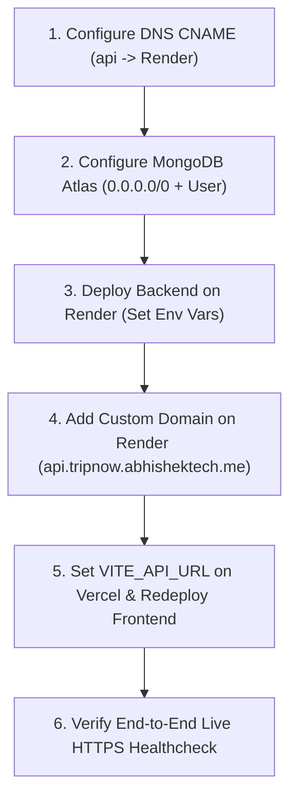

# TripNow Phase 4B — Production Environment Configuration Specification

**Author:** Senior DevOps Engineer  
**Date:** November 1, 2026  
**Phase:** 4B — Production Environment Configuration Preparation  
**Target Environments:**  
- Frontend: Vercel (`https://tripnow.abhishektech.me`)  
- Backend: Render (`https://api.tripnow.abhishektech.me`)  
- Database: MongoDB Atlas (Cluster 0)  
- Object Storage: Cloudinary  
- AI Provider: Google Gemini API (Google AI Studio)  

---

## 1. Executive Summary

This document establishes the definitive environment variable inventory, security parameters, and operational directives for deploying TripNow into production. 

Every configuration key listed has been forensically verified against the authoritative backend configuration loader (`backend/config/env.js`), route handlers, middleware, services, and the frontend client build configuration (`frontend/src/lib/api.js`).

Two concrete configuration defects in the repository's template files (`.env.example`) have been identified and documented with explicit operator remedies:
1. `FIX_DAY_PROPOSAL_SECRET` is enforced as mandatory in production in `backend/config/env.js`, but was omitted from `backend/.env.example`.
2. `GEMINI_MODEL=gemini-3.5-flash-lite` in `backend/.env.example` line 23 must NOT be copied to Render, as it bypasses the primary model (`gemini-3.6-flash`) and breaks runtime fallback logic.

---

## 2. Comprehensive Environment Variable Inventory

### 2.1 Backend Platform (Render Web Service)

| Variable Name | Required / Optional | Secret? | Code Verification | Purpose & Security Scope | Operator Action Required |
| :--- | :--- | :--- | :--- | :--- | :--- |
| `NODE_ENV` | **MANDATORY** | Non-Secret | `backend/config/env.js:13` | Triggers production defenses: enables `Secure` cookies, HSTS, strict CSRF validation, sanitizes error responses. | Set to `production` in Render service environment. |
| `PORT` | **MANDATORY** (Auto) | Non-Secret | `backend/config/env.js:63` | Port for Express HTTP listener. Render automatically injects `10000`, or defaults to `5000`. | Leave blank or set to `5000` (Render defaults take precedence). |
| `MONGO_URI` | **MANDATORY** | **SECRET** | `backend/config/env.js:17` | MongoDB Atlas TLS connection string. Process exits with status 1 if invalid. | Enter Atlas connection string with least-privilege user scoped to `tripnow_prod`. |
| `CLIENT_URL` | **MANDATORY** | Non-Secret | `backend/config/env.js:53` | Canonical allowed origin for CORS and client links. Must match frontend domain. | Set to `https://tripnow.abhishektech.me` (no trailing slash). |
| `JWT_SECRET` | **MANDATORY** | **SECRET** | `backend/config/env.js:18` | Cryptographic secret for signing/verifying session JWTs. | Generate 64-character random string (e.g. `openssl rand -hex 32`). |
| `JWT_EXPIRES_IN` | **OPTIONAL** | Non-Secret | `backend/config/env.js:66` | Session lifetime. Synced with HttpOnly cookie `maxAge`. Defaults to `2h`. | Leave blank to default to `2h`, or specify format like `2h` or `24h`. |
| `CSRF_SECRET` | **MANDATORY** | **SECRET** | `backend/config/env.js:34` | Dedicated HMAC key for double-submit CSRF protection. Must be >= 32 chars and distinct from `JWT_SECRET`. | Generate distinct 64-character random string. Must NOT match `JWT_SECRET`. |
| `FIX_DAY_PROPOSAL_SECRET` | **MANDATORY** | **SECRET** | `backend/config/env.js:21` | Dedicated HMAC key for signing/verifying Fix Day candidate proposals. Prevents parameter tampering. | Generate distinct 64-character random string. Must NOT match `JWT_SECRET`. |
| `ADMIN_EMAIL` | **MANDATORY** | Non-Secret | `backend/config/env.js:20` | Identity for admin dashboard gateway and operations. | Specify dedicated operations admin email address. |
| `ADMIN_PASSWORD` | **MANDATORY** | **SECRET** | `backend/config/env.js:19` | Password for admin authentication gateway. | Generate strong random password (minimum 24 characters). |
| `GEMINI_API_KEY` | **MANDATORY** (Feature) | **SECRET** | `backend/services/aiService.js:135` | Google AI Studio API key for itinerary generation and pivots. | Enter active Google AI Studio API key. |
| `GEMINI_MODEL` | **OPTIONAL** | Non-Secret | `backend/config/env.js:78` | Primary AI model. Code defaults to `gemini-3.6-flash`. | **Do NOT set to `gemini-3.5-flash-lite`**. Set to `gemini-3.6-flash` or leave unset. |
| `CLOUDINARY_CLOUD_NAME` | **MANDATORY** (Upload) | Non-Secret | `backend/services/storageService.js:25` | Cloudinary account cloud identifier for image cover uploads. | Enter Cloudinary cloud name. |
| `CLOUDINARY_API_KEY` | **MANDATORY** (Upload) | Non-Secret | `backend/services/storageService.js:26` | Cloudinary API key used by backend upload stream. | Enter Cloudinary API key. |
| `CLOUDINARY_API_SECRET` | **MANDATORY** (Upload) | **SECRET** | `backend/services/storageService.js:27` | Cloudinary API secret for signing media uploads. Kept backend-only. | Enter Cloudinary API secret. |
| `CLOUDINARY_URL` | **OPTIONAL** | **SECRET** | `backend/services/storageService.js:23` | Alternative single-string Cloudinary configuration URI. | Leave unset if individual keys are provided. |
| `EMAILJS_SERVICE_ID` | **OPTIONAL** (Email) | Non-Secret | `backend/utils/email.js:15` | EmailJS service ID for password reset and verification emails. | Enter EmailJS service ID if email recovery is activated. |
| `EMAILJS_PUBLIC_KEY` | **OPTIONAL** (Email) | Non-Secret | `backend/utils/email.js:16` | EmailJS public user ID. | Enter EmailJS public key. |
| `EMAILJS_PRIVATE_KEY` | **OPTIONAL** (Email) | **SECRET** | `backend/utils/email.js:17` | EmailJS private access token. Kept backend-only. | Enter EmailJS private accessToken. |
| `EMAILJS_RESET_TEMPLATE_ID` | **OPTIONAL** (Email) | Non-Secret | `backend/utils/email.js:18` | EmailJS template ID for password reset template. | Enter template ID configured with `{{to_email}}`, `{{link}}`. |
| `EMAILJS_VERIFY_TEMPLATE_ID` | **OPTIONAL** (Email) | Non-Secret | `backend/utils/email.js:19` | EmailJS template ID for email verification template. | Enter template ID configured with `{{to_email}}`, `{{link}}`. |

---

### 2.2 Frontend Platform (Vercel Project)

| Variable Name | Required / Optional | Secret? | Code Verification | Purpose & Security Scope | Operator Action Required |
| :--- | :--- | :--- | :--- | :--- | :--- |
| `VITE_API_URL` | **MANDATORY** | Non-Secret | `frontend/src/lib/api.js:3` | Base URL for all API requests, Axios instance, cold-start wakeups, and public share routes. | Set to `https://api.tripnow.abhishektech.me` in Vercel project settings. |

> [!CAUTION]
> **No Backend Secrets in Vercel:** Do NOT set `JWT_SECRET`, `GEMINI_API_KEY`, `MONGO_URI`, or `CLOUDINARY_API_SECRET` in Vercel. Vite client builds embed any environment variable into client-side JavaScript. Only `VITE_API_URL` is needed.

---

## 3. Gemini Model Architecture & Fallback Verification

### 3.1 Primary and Fallback Specifications
- **Primary Model:** `gemini-3.6-flash`
- **Fallback Model:** `gemini-3.5-flash-lite`
- **Implementation Source:** `backend/services/geminiClient.js`:
  ```javascript
  const DEFAULT_MODEL = "gemini-3.6-flash";
  const FALLBACK_MODEL = "gemini-3.5-flash-lite";

  const getModelName = () => {
    return env.geminiModel || DEFAULT_MODEL;
  };
  ```

### 3.2 Configuration Trap & Defect Remedy
In `backend/.env.example` line 23, the repository contains:
```env
GEMINI_MODEL=gemini-3.5-flash-lite
```
If an operator copies this template value into Render:
1. `env.geminiModel` is set to `"gemini-3.5-flash-lite"`.
2. The initial call immediately uses `"gemini-3.5-flash-lite"`, bypassing the higher-fidelity `gemini-3.6-flash` model.
3. The fallback condition in `geminiClient.js`:
   ```javascript
   if (isNewUserDeprecation && usedModel !== FALLBACK_MODEL)
   ```
   evaluates to `false` because `usedModel` is already equal to `FALLBACK_MODEL`. The fallback mechanism is permanently disabled.

**Mandatory Operator Configuration Directive:**
In Render Web Service environment variables:
- Either set `GEMINI_MODEL=gemini-3.6-flash`
- Or omit `GEMINI_MODEL` entirely so `backend/config/env.js` defaults to `"gemini-3.6-flash"`.

---

## 4. Security Architecture & Threat Defense Review

### 4.1 Cryptographic Key Separation
- **`JWT_SECRET`:** Dedicated to signing user authentication tokens (`token` cookie / Bearer).
- **`CSRF_SECRET`:** Dedicated to signing double-submit CSRF tokens. Verified in `backend/config/env.js`:
  ```javascript
  if (secret === process.env.JWT_SECRET) {
    throw new Error("CSRF_SECRET must be independent and cannot be identical to JWT_SECRET in production.");
  }
  ```
- **`FIX_DAY_PROPOSAL_SECRET`:** Dedicated to HMAC-SHA256 signing of Fix Day candidate replacements in `backend/services/fixDayService.js`. Never shares keys with JWT or CSRF.

### 4.2 Cross-Subdomain Cookie & Origin Security
- **Frontend Origin:** `https://tripnow.abhishektech.me`
- **Backend API Origin:** `https://api.tripnow.abhishektech.me`
- **CORS Configuration:** Enforced strictly in `backend/app.js`:
  ```javascript
  app.use(cors({
    origin(origin, callback) {
      if (!origin) return callback(null, true);
      if (allowedOrigins.includes(origin)) return callback(null, true);
      const err = new Error(`CORS: origin ${origin} not allowed`);
      err.statusCode = 403;
      return callback(err);
    },
    credentials: true,
  }));
  ```
- **Cookie Security:** Enforced in `backend/config/authCookie.js`:
  - `httpOnly: true` (prevents JavaScript access and XSS theft).
  - `secure: true` (enforced via `env.isProduction`; transmitted exclusively over HTTPS).
  - `sameSite: "lax"` (both domains share parent domain `abhishektech.me`, treated as same-site by modern browsers; ambient credentials are preserved with `withCredentials: true`).
- **Fetch Metadata & CSRF Defense:** Enforced in `backend/middleware/csrf.js`:
  - Validates `Origin` and `Referer` against `allowedOrigins`.
  - Rejects `Sec-Fetch-Site: cross-site`.
  - Enforces timing-safe HMAC validation of `X-CSRF-Token` on all state-mutating requests (`POST`, `PUT`, `PATCH`, `DELETE`).

### 4.3 Database Security & Least Privilege
- **Network Access:** `0.0.0.0/0` in MongoDB Atlas Network Access is operationally required due to dynamic AWS EC2 IP pools on Render standard tiers.
- **Access Control:** Production database user must be granted `readWrite@tripnow_prod` exclusively. The user must NOT hold `atlasAdmin`, `clusterAdmin`, or `readWriteAnyDatabase` privileges.
- **Wire Security:** TLS 1.2+ encryption is enforced by MongoDB Atlas cluster settings.

### 4.4 Cloudinary Storage Isolation
- All Cloudinary API operations are executed server-side via `backend/services/storageService.js`.
- Neither `CLOUDINARY_API_KEY` nor `CLOUDINARY_API_SECRET` is bundled into frontend assets.
- If storage credentials are omitted in production, `uploadImage` throws an explicit 503 error (`"Media storage service is unavailable"`), preventing silent data loss or memory leaks.

---

## 5. Configuration Defects & Pre-Flight Blockers

### 5.1 Identified Configuration Defects
1. **Missing `FIX_DAY_PROPOSAL_SECRET` in `backend/.env.example`:**
   - *Defect:* `backend/config/env.js` requires `FIX_DAY_PROPOSAL_SECRET` when `NODE_ENV=production`. If an operator bases Render configuration solely on `.env.example`, the backend will crash on boot.
   - *Remedy:* Operator must explicitly provision a dedicated 64-character string for `FIX_DAY_PROPOSAL_SECRET` in Render.
2. **Suboptimal Model Default in `backend/.env.example`:**
   - *Defect:* Line 23 specifies `GEMINI_MODEL=gemini-3.5-flash-lite`, which overrides the primary model.
   - *Remedy:* Operator must set `GEMINI_MODEL=gemini-3.6-flash` or omit the variable in Render.
3. **Dead Variables in Local `frontend/.env`:**
   - *Defect:* Local uncommitted `frontend/.env` contains `VITE_GOOGLE_MAPS_API_KEY` and `VITE_OPENWEATHER_API_KEY`. Neither variable is referenced anywhere in the codebase.
   - *Remedy:* Do NOT add these variables to Vercel.

### 5.2 Deployment Blockers
1. **DNS CNAME Record for API Subdomain:**
   - `api.tripnow.abhishektech.me` currently returns `NXDOMAIN`.
   - Must be pointed to the Render service address (e.g. `tripnow-api.onrender.com`) before HTTPS and API requests can function.

---

## 6. Step-by-Step Operator Runbook



### Step 1: DNS Configuration (Registrar / DNS Provider)
Add the following record:
- **Type:** `CNAME`
- **Host:** `api` (or `api.tripnow.abhishektech.me`)
- **Points to:** Render Web Service URL (e.g., `<service-name>.onrender.com`)
- **TTL:** 300s (or Automatic)

### Step 2: MongoDB Atlas Setup
1. Log in to MongoDB Atlas -> **Network Access** -> Add IP Address: `0.0.0.0/0` (Comment: `Render Dynamic Egress`).
2. Go to **Database Access** -> Add New Database User:
   - Authentication Method: Password.
   - Database User Privileges: Built-in Role -> `Read and write to any database` restricted to `tripnow_prod`.
   - Copy the connection string format: `mongodb+srv://<user>:<password>@cluster0.mongodb.net/tripnow_prod?retryWrites=true&w=majority`.

### Step 3: Render Backend Environment Variables
Under Render Web Service -> **Environment**:
```env
NODE_ENV=production
PORT=5000
CLIENT_URL=https://tripnow.abhishektech.me
MONGO_URI=mongodb+srv://<user>:<password>@cluster0.mongodb.net/tripnow_prod?retryWrites=true&w=majority
JWT_SECRET=<64-char-random-hex>
CSRF_SECRET=<64-char-random-hex-distinct-from-jwt>
FIX_DAY_PROPOSAL_SECRET=<64-char-random-hex-distinct-from-jwt-and-csrf>
ADMIN_EMAIL=<admin-operations-email>
ADMIN_PASSWORD=<strong-random-password>
GEMINI_API_KEY=<google-ai-studio-api-key>
GEMINI_MODEL=gemini-3.6-flash
CLOUDINARY_CLOUD_NAME=<cloudinary-cloud-name>
CLOUDINARY_API_KEY=<cloudinary-api-key>
CLOUDINARY_API_SECRET=<cloudinary-api-secret>
```
*(Optional EmailJS variables if password recovery is required at launch):*
```env
EMAILJS_SERVICE_ID=<service-id>
EMAILJS_PUBLIC_KEY=<public-key>
EMAILJS_PRIVATE_KEY=<private-key>
EMAILJS_RESET_TEMPLATE_ID=<template-id>
EMAILJS_VERIFY_TEMPLATE_ID=<template-id>
```

### Step 4: Render Custom Domain Attachment
1. In Render Web Service -> **Settings** -> **Custom Domains**:
2. Add `api.tripnow.abhishektech.me`.
3. Verify that Render reports the certificate as issued and active.

### Step 5: Vercel Frontend Configuration
1. Log in to Vercel -> Project Settings -> **Environment Variables**.
2. Add:
   - Key: `VITE_API_URL`
   - Value: `https://api.tripnow.abhishektech.me`
   - Environments: `Production`, `Preview`, `Development`
3. Trigger a **Redeploy** on Vercel so the production bundle embeds the live API domain.

---

## 7. Final Validation & Healthcheck Directives

After completing the operator actions:
1. **API Health Check:**
   ```bash
   curl -I https://api.tripnow.abhishektech.me/api/health
   # Expected: HTTP/1.1 200 OK
   ```
2. **CSRF Token Issuance:**
   ```bash
   curl https://api.tripnow.abhishektech.me/api/csrf-token
   # Expected: {"success":true,"csrfToken":"..."}
   ```
3. **Frontend Application Load:**
   Open `https://tripnow.abhishektech.me` in a clean browser session. Verify itinerary generation, user authentication, and trip persistence.

