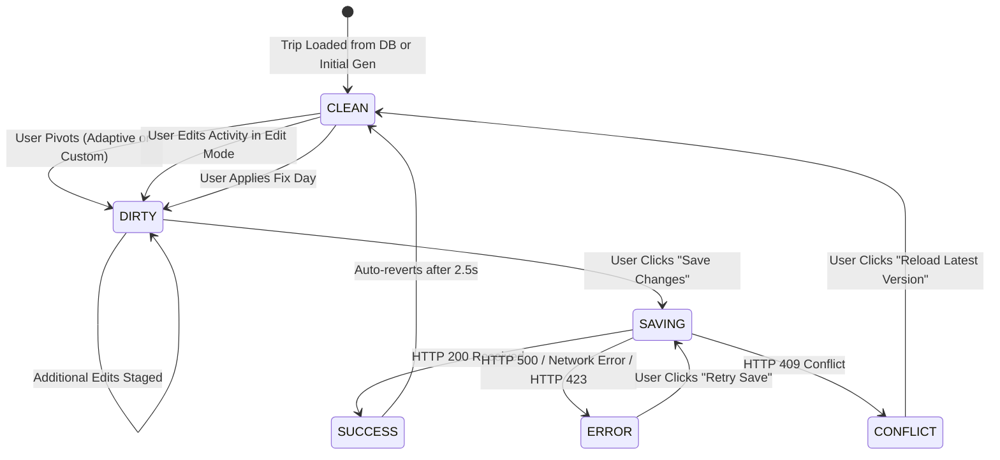

# TripNow Phase 3C — Implementation Report: Pivot Save & Itinerary Persistence

**Author:** Senior Full-Stack Engineer, Express & React Architect, API Security Specialist  
**Date:** 2026-11-01  
**Status:** **IMPLEMENTATION COMPLETE**  
**Deliverable Document:** `docs/pivot/phase3c-implementation.md`  

---

## 1. Executive Summary

Phase 3C has successfully implemented the **Pivot Save & Itinerary Persistence** architecture for TripNow, resolving the previously identified architectural gap where AI pivots were automatically persisted on the server while manual edits never reached the database.

With Phase 3C:
1. **Decoupled Workflow:** Adaptive Pivot, Custom Pivot, and day-level editing now generate candidate replacements staged in React memory without auto-persisting.
2. **Dedicated Persistence Endpoint:** A secure, dedicated endpoint (`PATCH /api/bookings/:id/itinerary`) commits reviewed itineraries into `Booking.aiPlan` with Optimistic Concurrency Control (`__v`) and server-enforced activity lock invariants.
3. **Existing Trip Reloading:** `PlanTrip.jsx` detects existing trip routes (`/trip/:id`), fetches the authoritative booking record via `GET /api/bookings/:id`, and renders the persisted itinerary without triggering redundant calls to `POST /api/ai`.
4. **Explicit UI State Model:** A 6-state status machine (`CLEAN`, `DIRTY`, `SAVING`, `SUCCESS`, `ERROR`, `CONFLICT`) gives travelers clear, unambiguous feedback on whether their itinerary is saved, and protects unsaved work during navigation.

---

## 2. Dedicated Endpoint Contract: `PATCH /api/bookings/:id/itinerary`

### 2.1 Route & Middleware Stack
- **HTTP Route:** `PATCH /api/bookings/:id/itinerary`
- **Controller:** `bookingController.updateItinerary`
- **Route Definition:** [`backend/routes/bookingRoutes.js`](file:///d:/all%20project/Travel%20Website/backend/routes/bookingRoutes.js)
- **Middleware Chain:**
  1. `protect`: Validates session authentication (JWT in HttpOnly cookie). Scopes request to `req.user._id`.
  2. `validateObjectId("id")`: Validates 24-character hexadecimal MongoDB ObjectId.
  3. `csrfProtection`: Validates session-bound `x-csrf-token` header.
  4. `validate(itineraryPersistenceSchema)`: Zod schema enforcing valid days, blocks, activities, and non-negative `baseVersion`.

### 2.2 Request Payload
```json
{
  "itinerary": {
    "destination": "Goa, India",
    "days": [
      {
        "day": 1,
        "title": "North Goa Beaches",
        "morning": "Baga Beach stroll and water sports",
        "afternoon": "Calangute Beach Café — Relaxing coffee and ocean view",
        "evening": "Sunset dining at Curlies",
        "activities": [
          {
            "id": "d1-morning-01",
            "period": "morning",
            "title": "Baga Beach stroll",
            "description": "Water sports and walking",
            "category": "Adventure & Outdoors",
            "durationMinutes": 120,
            "cost": "Free",
            "indoorOutdoor": "Outdoor",
            "locked": false
          }
        ]
      }
    ],
    "budgetBreakdown": { "total": "$500" },
    "travelTips": ["Rent a scooter for easy travel"]
  },
  "baseVersion": 0
}
```

### 2.3 Response Contracts

#### Success Response (`HTTP 200 OK`):
```json
{
  "success": true,
  "message": "Itinerary saved successfully",
  "data": {
    "_id": "6ae6d52bbbd79cceca346d5e",
    "destination": "Goa, India",
    "guests": 2,
    "checkin": "2026-11-10T00:00:00.000Z",
    "checkout": "2026-11-12T00:00:00.000Z",
    "budget": "$500",
    "aiPlan": "{\"destination\":\"Goa, India\",\"days\":[...]}",
    "realityScore": {
      "score": 85,
      "tier": "Realistic",
      "breakdown": { ... }
    },
    "__v": 1
  }
}
```

#### Optimistic Concurrency Conflict (`HTTP 409 Conflict`):
```json
{
  "success": false,
  "message": "Conflict: Trip was modified concurrently by another action. Please refresh and try again.",
  "currentVersion": 2,
  "expectedVersion": 0
}
```

#### Lock Invariant Violation (`HTTP 423 Locked`):
```json
{
  "success": false,
  "message": "Cannot modify locked activity 'Basilica of Bom Jesus'. Please unlock the activity first."
}
```

---

## 3. Version-Control Strategy & Optimistic Concurrency

1. **Mongoose Version Key (`__v`):**
   - The application leverages the built-in Mongoose `__v` counter.
   - When the client proposals an update, it provides `baseVersion` (the version of the document it loaded).
2. **Server-Side Verification:**
   - The server first checks `existingTrip.__v === parsedBaseVersion`.
   - The atomic update query requires `{ _id: id, user: req.user._id, __v: parsedBaseVersion }` and executes `$inc: { __v: 1 }`.
   - If a race condition occurs, `findOneAndUpdate` returns `null`, causing the server to emit an HTTP 409 Conflict response.
3. **No Duplicate Version Bumps:**
   - The version increments exactly once per successful save operation.

---

## 4. Activity Lock Invariant Implementation

Before committing the updated itinerary:
1. The server loads the authoritative persisted `aiPlan` from MongoDB and normalizes it using `normalizeItinerary`.
2. It locates every activity where `locked === true` and maps them by their stable identifier (`id`).
3. It normalizes the incoming client itinerary and verifies:
   - **Identity Presence:** The locked activity ID must exist in the submitted payload (cannot be deleted; returns HTTP 423).
   - **Lock Status:** The activity cannot be silently unlocked in the save payload (returns HTTP 423; traveler must use dedicated lock toggle).
   - **Content Immutability:** The protected fields (`title`, `description`, `period`, `category`, `indoorOutdoor`) cannot differ from the persisted state (returns HTTP 423).
4. If all locked activities remain pristine, the mutation is authorized.

---

## 5. Decoupling Pivot Generation from Persistence

In [`backend/services/pivotService.js`](file:///d:/all%20project/Travel%20Website/backend/services/pivotService.js):
- `executePivot` now accepts an explicit parameter: `autoPersist = false`.
- When `autoPersist: false`:
  - It generates the replacement candidate via Gemini.
  - It validates semantic constraints (e.g. weather rules).
  - It constructs the staged mutated plan.
  - It **does not touch MongoDB**.
  - It returns `{ replacement, formattedBlock, stagedPlan, persisted: false }`.
- When `autoPersist: true` is passed (for backward compatibility with standalone service callers):
  - It performs the atomic `Booking.findOneAndUpdate` with OCC version increment.
- The user-facing controller [`backend/controllers/aiController.js`](file:///d:/all%20project/Travel%20Website/backend/controllers/aiController.js) explicitly sets `autoPersist: false`.

---

## 6. Frontend State Machine & Staging

In [`frontend/src/pages/PlanTrip.jsx`](file:///d:/all%20project/Travel%20Website/frontend/src/pages/PlanTrip.jsx):



### Visual & Interactive Elements:
- **Save Changes Button:**
  - `CLEAN`: Gray/slate, disabled: `✓ Changes Saved`.
  - `DIRTY`: Amber with badge: `💾 Save Changes (Unsaved)`.
  - `SAVING`: Animated spinner: `⏳ Saving...`.
  - `SUCCESS`: Green checkmark: `✅ Saved!`.
  - `CONFLICT`: Red badge: `⚡ Conflict — Reload`.
  - `ERROR`: Alert style: `⚠️ Retry Save`.
- **Conflict Banner:** Prominently alerts traveler if another tab updated the trip, providing a one-click `Reload Latest Version` button.
- **Unsaved Navigation Guards:**
  - `beforeunload` event handler prompts when closing tab with dirty state.
  - Discard Confirmation Modal intercepts in-app navigation (`safeNavigate`) to `/dashboard` or `/`.

---

## 7. Anonymous User Draft Handling

If an unauthenticated user customizes an itinerary:
1. The user can perform Adaptive and Custom Pivots in local React memory.
2. Clicking **Save Changes** detects `!getUser()`.
3. An accessible authentication modal prompts:
   *"Please log in or create an account to save your customized itinerary and access it anytime from your dashboard. Your staged changes have been preserved."*
4. Clicking "Log In / Sign Up" navigates to `/login` passing `{ returnTo: location.pathname, stagedTrip: tripData, tripId }` in location state.
5. Tokens remain strictly in secure HttpOnly cookies; no tokens or user credentials are stored in localStorage or sessionStorage.

---

## 8. Reality Score Synchronization Decision

- **Deterministic In-Process Evaluation:**
  - The Reality Engine orchestrator [`backend/services/realityEngine/index.js`](file:///d:/all%20project/Travel%20Website/backend/services/realityEngine/index.js) calculates scores using purely deterministic algorithms (time, budget, pace, route).
  - It does **not** call Google Gemini or external network APIs.
- **Atomic Database Sync:**
  - When `PATCH /api/bookings/:id/itinerary` executes, the server computes `evaluateTripReality({ aiPlan: incomingPlan, budget: existingTrip.budget })` and persists the updated score into `Booking.realityScore` within the same atomic MongoDB `$set`.
  - The saved itinerary and database reality score remain 100% consistent at zero additional Gemini cost.

---

## 9. Files Changed

| File Path | Description of Changes |
| :--- | :--- |
| [`backend/validators/bookingValidators.js`](file:///d:/all%20project/Travel%20Website/backend/validators/bookingValidators.js) | Added `itineraryPersistenceSchema` with Zod validation for days, activities, and baseVersion. |
| [`backend/controllers/bookingController.js`](file:///d:/all%20project/Travel%20Website/backend/controllers/bookingController.js) | Added `updateItinerary` controller method with ownership check, OCC check, lock invariants, reality score sync, and atomic `$set`. |
| [`backend/routes/bookingRoutes.js`](file:///d:/all%20project/Travel%20Website/backend/routes/bookingRoutes.js) | Registered `PATCH /:id/itinerary` route with `protect`, `validateObjectId`, and `itineraryPersistenceSchema`. |
| [`backend/services/pivotService.js`](file:///d:/all%20project/Travel%20Website/backend/services/pivotService.js) | Added explicit `autoPersist = false` option to decouple candidate generation from database writes. |
| [`backend/controllers/aiController.js`](file:///d:/all%20project/Travel%20Website/backend/controllers/aiController.js) | Updated `pivotAITrip` to invoke `executePivot` with `autoPersist: false`. |
| [`backend/tests/itineraryPersistence.test.js`](file:///d:/all%20project/Travel%20Website/backend/tests/itineraryPersistence.test.js) | Created 13-test suite covering auth, ownership, schema, OCC, lock invariants, duplicate submits, and legacy plans. |
| [`backend/tests/pivot.test.js`](file:///d:/all%20project/Travel%20Website/backend/tests/pivot.test.js) | Updated assertions to verify staging without persistence and backward compatibility for autoPersist=true. |
| [`backend/tests/lock.test.js`](file:///d:/all%20project/Travel%20Website/backend/tests/lock.test.js) | Updated pivot lock integration test to verify staged structured activity candidate. |
| [`frontend/src/services/bookingService.js`](file:///d:/all%20project/Travel%20Website/frontend/src/services/bookingService.js) | Added `getTripById(id)` and `saveItinerary(id, { itinerary, baseVersion })`. |
| [`frontend/src/pages/PlanTrip.jsx`](file:///d:/all%20project/Travel%20Website/frontend/src/pages/PlanTrip.jsx) | Wired `useParams()`, trip loading without duplicate AI calls, dirty state tracking, Save Changes button, conflict banner, and navigation guards. |

---

## 10. Known Limitations

1. **Guest Staged Trip Expiration:** If an anonymous user closes their browser window entirely instead of logging in, local memory state is cleared.
2. **Offline Mode:** The Save Changes action requires active network connectivity to commit to MongoDB Atlas and verify CSRF tokens.

