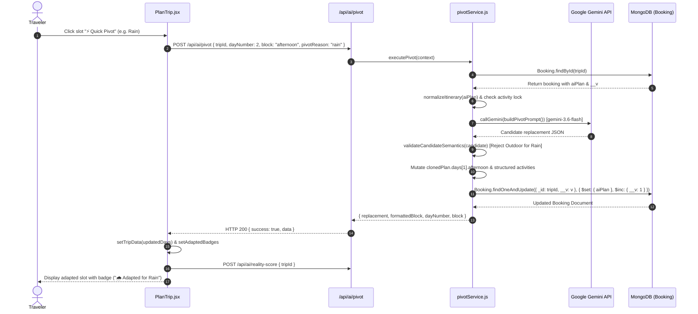
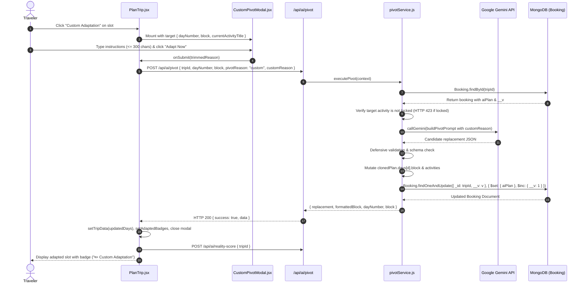
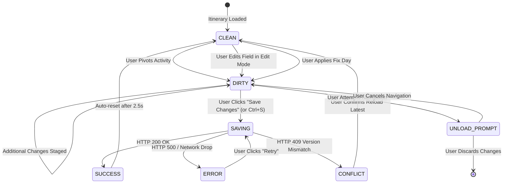
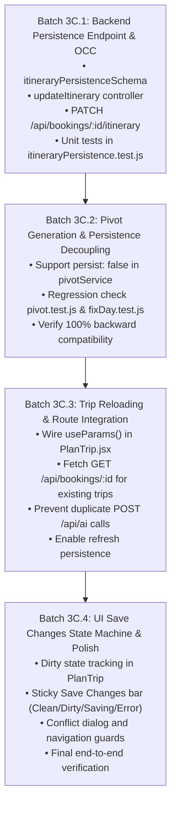

# TripNow Phase 3C — Architecture Audit: Pivot Save & Itinerary Persistence

**Author:** Senior Full-Stack Architect, API Specialist, Node.js & React Engineer  
**Date:** 2026-11-01  
**Status:** **AUDIT ONLY — READ-ONLY DOCUMENT**  
**Target Document:** `docs/pivot/phase3c-save-persistence-audit.md`  

---

## 1. Executive Summary

This architecture audit evaluates the end-to-end data flow, persistence boundaries, security posture, and user experience for **Phase 3C: Pivot Save & Itinerary Persistence** in the TripNow application.

### Key Audit Findings:
1. **Existing Persistence Behavior in Pivoting:**
   - **Verified Fact:** In the current backend implementation (`backend/services/pivotService.js`, lines 514–521), `executePivot` **automatically and atomically persists** every Adaptive and Custom Pivot directly into MongoDB via `Booking.findOneAndUpdate({ _id: tripId, __v: currentVersion }, { $set: { aiPlan: planToSave }, $inc: { __v: 1 } })`.
   - **Frontend State:** `PlanTrip.jsx` (lines 188–214) updates its local `tripData` state upon receiving the replacement block, recalculates the Reality Score, and displays badges, but offers no intermediate "review-then-save" user gate for AI pivots.
   - **Manual Edits Divergence:** Conversely, manual text edits made under "Edit Trip" (`editMode = true`) in `PlanTrip.jsx` (line 771) are purely in-memory (`setTripData(editableTrip); setEditMode(false);`) and **never persist** to MongoDB.
2. **Persistence Endpoint Limitations:**
   - The general update endpoint `PUT /api/bookings/:id` enforces a strict allowlist of 11 metadata fields (`destination`, `checkin`, `checkout`, `guests`, `budget`, `notes`, `fullName`, `email`, `phone`, `dayCount`, `coverImage`). It intentionally strips and ignores `aiPlan` and `tripData` to prevent mass assignment.
   - There is currently **no generic API endpoint** for saving an updated itinerary.
3. **Trip Reloading Gap:**
   - When a user navigates from `Dashboard.jsx` to an existing trip (`navigate('/trip/${trip._id}', { state: trip })`), `trip` contains only projected dashboard fields (ARCH-02) and lacks `aiPlan`.
   - In `PlanTrip.jsx` (lines 110–147), the component does not fetch `GET /api/bookings/:id`. Instead, it unconditionally calls `POST /api/ai`, triggering a brand-new AI trip generation and creating an extraneous duplicate `Booking` record in MongoDB.
   - If a user refreshes `/trip/:id` in their browser, line 111 detects `!state` and immediately redirects to `"/"`, losing context completely.

### High-Level Recommendation:
To satisfy the required workflow where generation and persistence are decoupled and trips can be refreshed or reopened reliably:
1. Implement a dedicated, secure endpoint: `PATCH /api/bookings/:id/itinerary` protected by user authentication, CSRF validation, strict Zod schema validation, and Optimistic Concurrency Control (`__v`).
2. Update `PlanTrip.jsx` to detect existing trips via `useParams()`, load their full persisted itinerary via `GET /api/bookings/:id`, and avoid calling `POST /api/ai` on existing records.
3. Introduce an explicit **Dirty State & Save Changes** interface in `PlanTrip.jsx` that enables users to review generated pivots and manual modifications before persisting them to the database.

---

## 2. Actual Architecture & File References

The audit is grounded strictly in the current codebase files and verified Git history:

### 2.1 Frontend Files
- [`frontend/src/pages/PlanTrip.jsx`](file:///d:/all%20project/Travel%20Website/frontend/src/pages/PlanTrip.jsx): Primary trip planning and itinerary canvas. Manages `tripData`, `editableTrip`, `adaptedBadges`, `pivotTarget`, `editMode`, and reality scoring.
- [`frontend/src/components/pivot/CustomPivotModal.jsx`](file:///d:/all%20project/Travel%20Website/frontend/src/components/pivot/CustomPivotModal.jsx): Standalone modal dialog for submitting custom natural-language adaptation instructions.
- [`frontend/src/pages/Dashboard.jsx`](file:///d:/all%20project/Travel%20Website/frontend/src/pages/Dashboard.jsx): User dashboard displaying saved trips using projected queries (`GET /api/bookings`).
- [`frontend/src/services/bookingService.js`](file:///d:/all%20project/Travel%20Website/frontend/src/services/bookingService.js): Client API abstraction for booking creation, deletion, metadata updates, and sharing.
- [`frontend/src/lib/api.js`](file:///d:/all%20project/Travel%20Website/frontend/src/lib/api.js): Axios instance configured with `withCredentials: true` and automated CSRF token synchronization via `/api/csrf-token`.
- [`frontend/src/App.jsx`](file:///d:/all%20project/Travel%20Website/frontend/src/App.jsx): Routes `/plan-trip` and `/trip/:id` to `PlanTrip.jsx`.

### 2.2 Backend Files
- [`backend/models/Booking.js`](file:///d:/all%20project/Travel%20Website/backend/models/Booking.js): Authoritative trip document schema containing `aiPlan` (Mixed), `destination`, `checkin`, `checkout`, `budget`, `realityScore`, `user`, and `__v`.
- [`backend/controllers/bookingController.js`](file:///d:/all%20project/Travel%20Website/backend/controllers/bookingController.js): Handles booking CRUD. Lines 75–85 enforce the `allowedFields` metadata filter.
- [`backend/routes/bookingRoutes.js`](file:///d:/all%20project/Travel%20Website/backend/routes/bookingRoutes.js): Express router protected by `auth` middleware (`protect`) and `validateObjectId`.
- [`backend/validators/bookingValidators.js`](file:///d:/all%20project/Travel%20Website/backend/validators/bookingValidators.js): Zod schemas for `createBookingSchema` and `updateBookingSchema`.
- [`backend/services/pivotService.js`](file:///d:/all%20project/Travel%20Website/backend/services/pivotService.js): Core execution service for Adaptive and Custom Pivot, Gemini model coordination, semantic verification, and surgical MongoDB persistence.
- [`backend/controllers/aiController.js`](file:///d:/all%20project/Travel%20Website/backend/controllers/aiController.js): Dispatches `pivotAITrip`, `generateAITrip`, `lockActivity`, and `getRealityScore`.
- [`backend/utils/itineraryNormalizer.js`](file:///d:/all%20project/Travel%20Website/backend/utils/itineraryNormalizer.js): Normalizes raw JSON or string itineraries into structured activities (`id`, `period`, `title`, `description`, `cost`, `durationMinutes`, `locked`).
- [`backend/services/lockService.js`](file:///d:/all%20project/Travel%20Website/backend/services/lockService.js): Manages individual activity locking and atomic persistence.
- [`backend/services/fixDayService.js`](file:///d:/all%20project/Travel%20Website/backend/services/fixDayService.js): Handles two-stage day-level rebalancing (Preview with signed proposal token $\rightarrow$ Apply with OCC).

---

## 3. Adaptive Pivot Data-Flow Diagram

The following sequence illustrates the current data flow for **Adaptive Pivot** (e.g., weather disruption, fatigue, venue closure):



---

## 4. Custom Pivot Data-Flow Diagram

The following sequence illustrates the current data flow for **Custom Pivot** via the consolidated modal:



---

## 5. Current Booking Schema & Itinerary Field Analysis

Inspection of [`backend/models/Booking.js`](file:///d:/all%20project/Travel%20Website/backend/models/Booking.js) reveals the exact database representation:

| Field Name | Type | Characteristics & Default | Role in Trip Architecture |
| :--- | :--- | :--- | :--- |
| `_id` | `ObjectId` | Auto-generated primary key | Authoritative trip identifier across all APIs. |
| `user` | `ObjectId` | Ref `User`, index: true, default `null` | Trip owner. Used for ownership checks (`trip.user.toString() === req.user._id.toString()`). |
| `destination` | `String` | Required, trimmed, max 120 | Primary geographic destination. |
| `guests` | `Number` | Required, integer, min 1 | Traveler count. |
| `checkin` | `Date` | Required | Start date of trip. |
| `checkout` | `Date` | Required, validated `checkout > checkin` | End date of trip. |
| `budget` | `String` | Optional, default `null` | High-level budget tier (e.g., "$2000" or "Moderate"). |
| `dayCount` | `Number` | Integer, default `0` | Calculated duration in days. |
| `aiPlan` | `Mixed` | Mongoose Mixed type, default `null` | **Authoritative itinerary store.** Holds full JSON structure. |
| `tripData` | `Mixed` | Mongoose Mixed type, default `null` | Auxiliary payload created by `Booking.jsx` during checkout. |
| `realityScore` | `Mixed` | Mongoose Mixed type, default `null` | Cached deterministic reality report. |
| `coverImage` | `String` | URL / Cloudinary public ID, default `null` | Trip card header photo. |
| `isShared` | `Boolean` | Boolean, index: true, default `false` | Controls whether `GET /api/bookings/shared/:id` is accessible. |
| `__v` | `Number` | Mongoose version key, default `0` | **Optimistic Concurrency Control (OCC) counter.** |
| `timestamps` | `Date` | `createdAt`, `updatedAt` | Auto-managed audit timestamps. |

### Itinerary Storage Structure:
- The complete itinerary is stored as **one unified document** inside the `aiPlan` field.
- Dates, day titles, morning/afternoon/evening prose strings, and structured activity arrays (`id`, `period`, `title`, `description`, `category`, `durationMinutes`, `cost`, `indoorOutdoor`, `locked`) are nested inside `aiPlan.days[]`.
- Activity locks are **not** stored in a separate table or collection; they are boolean properties (`locked: true | false`) on individual activity objects inside `aiPlan.days[i].activities[j]`.

---

## 6. Existing API Endpoint Analysis

| Endpoint & Method | Controller & Route | Validation & Permissions | Supports Itinerary Update? | Security Evaluation |
| :--- | :--- | :--- | :---: | :--- |
| `POST /api/bookings` | `bookingController.createBooking`<br>`bookingRoutes.js:29` | `protect`, `validate(createBookingSchema)` | Yes (at creation only) | Accepts `aiPlan` and `tripData` on initial save. Sanitizes owner to `req.user._id`. |
| `GET /api/bookings/mine` | `bookingController.getMyBookings`<br>`bookingRoutes.js:29` | `protect` | No (Read-only) | Projections explicitly exclude `aiPlan` for dashboard performance. |
| `GET /api/bookings/:id` | `bookingController.getBookingById`<br>`bookingRoutes.js:48` | `protect`, `validateObjectId("id")` | No (Read-only) | Loads full private booking including `aiPlan`, scoped strictly to `user: req.user._id`. |
| `PUT /api/bookings/:id` | `bookingController.updateBooking`<br>`bookingRoutes.js:48` | `protect`, `validateObjectId("id")`, `validate(updateBookingSchema)` | **NO** | **Explicitly blocks `aiPlan`.** Lines 75–85 restrict updates to 11 metadata fields to prevent arbitrary payload tampering. |
| `DELETE /api/bookings/:id`| `bookingController.deleteBooking`<br>`bookingRoutes.js:48` | `protect`, `validateObjectId("id")` | No (Deletes trip) | Scoped to owner. Cleans up cover photo if present. |
| `POST /api/ai/pivot` | `aiController.pivotAITrip`<br>`aiRoutes.js:25` | `optionalAuth`, Zod schema, Rate limited | Yes (Auto-persists single slot) | Verifies ownership, mutates single block in `aiPlan`, persists via OCC. Does not support full itinerary persistence. |
| `POST /api/ai/fix-day/apply` | `aiController.applyFixDayTrip`<br>`aiRoutes.js:29` | `optionalAuth`, Zod schema, Rate limited | Yes (Day-level apply) | Requires signed proposal token with baseVersion. |
| `POST /api/ai/activity/lock`| `aiController.lockActivity`<br>`aiRoutes.js:27` | `optionalAuth`, Zod schema | Yes (Lock toggle) | Toggles boolean lock flag inside `aiPlan` via OCC. |

### Conclusion on Endpoint Reuse:
Reusing `PUT /api/bookings/:id` for itinerary persistence is **strongly discouraged**:
1. It would violate the established security allowlist verified by `backend/tests/securityMiddleware.test.js` (line 295).
2. It lacks the complex structural validation needed for nested days, activities, and lock invariants.
3. A dedicated endpoint (`PATCH /api/bookings/:id/itinerary`) maintains clean separation of concerns and prevents regression risks.

---

## 7. Recommended Persistence Strategy

### 7.1 Proposed Dedicated Endpoint: `PATCH /api/bookings/:id/itinerary`

To provide a robust, safe, and isolated mechanism for persisting reviewed itineraries, we propose:

- **Route:** `PATCH /api/bookings/:id/itinerary`
- **Middleware:** `protect` (JWT in HttpOnly cookie), `validateObjectId("id")`, `validate(itineraryPersistenceSchema)`.
- **Request Payload:**
  ```json
  {
    "itinerary": {
      "destination": "Paris",
      "days": [
        {
          "day": 1,
          "title": "Historic Exploration",
          "morning": "Louvre Museum — World-renowned art collection",
          "afternoon": "Tuileries Garden — Stroll through historic royal gardens",
          "evening": "Seine River Dinner Cruise — Illuminated city views",
          "activities": [
            {
              "id": "d1-morning-01",
              "period": "morning",
              "title": "Louvre Museum",
              "description": "World-renowned art collection",
              "category": "Sightseeing",
              "durationMinutes": 180,
              "cost": "Moderate",
              "indoorOutdoor": "Indoor",
              "locked": false
            }
          ]
        }
      ],
      "budgetBreakdown": { "total": "$2000" },
      "whereToStay": { "midRange": "Hotel Marais" },
      "mustEat": ["Croissants at Du Pain et des Idées"],
      "travelTips": ["Book museum tickets in advance"],
      "bestTimeToVisit": "May to September"
    },
    "baseVersion": 3
  }
  ```

### 7.2 Controller & Service Logic:
1. **Ownership Authorization:**
   Verify `booking.user.toString() === req.user._id.toString()`.
2. **Optimistic Concurrency Check:**
   Query `Booking.findOne({ _id: req.params.id, user: req.user._id })`. Compare `booking.__v` with `baseVersion`. If mismatched, abort with HTTP 409 Conflict.
3. **Lock Invariant Verification:**
   Cross-reference every activity marked `locked: true` in the existing database document against the incoming payload. If a locked activity's core content was tampered with without being unlocked first, reject with HTTP 423.
4. **Structural Normalization:**
   Run `normalizeItinerary(req.body.itinerary)` to ensure all required Phase 2 structured fields are present and synchronized with prose blocks.
5. **Atomic Persistence:**
   Execute `Booking.findOneAndUpdate({ _id: req.params.id, __v: baseVersion }, { $set: { aiPlan: normalizedPlan }, $inc: { __v: 1 } }, { returnDocument: "after" })`.
6. **Reality Score Synchronization:**
   Trigger `evaluateTripReality(normalizedPlan)` and update `realityScore` in the same operation or return updated score in response.

### 7.3 Decoupling Generation from Auto-Persistence in Pivoting:
Currently, `pivotService.js` persists automatically. To support the requested review-then-save workflow without breaking existing tests:
- **Recommendation:** Add an optional boolean parameter `persist` (default: `true` in backend for backward compatibility with existing tests; set to `false` when called by the new frontend review flow).
- When `persist: false`, `executePivot` generates the candidate, validates semantics, constructs the updated in-memory itinerary object, and returns it to the client **without executing `Booking.findOneAndUpdate`**.
- The frontend holds the change in dirty state until the user clicks **Save Changes**.

---

## 8. Proposed Frontend Save Button State Model

To eliminate user confusion between generating AI pivots and saving reviewed changes, we define an explicit state machine:

### 8.1 State Definitions

| State Name | Visual Presentation | Button Behavior | Trigger Event |
| :--- | :--- | :--- | :--- |
| **`CLEAN`** | Gray / outline button: `✓ Changes Saved` | Disabled (cursor-default) | Initial load; immediately following successful save. |
| **`DIRTY`** | Highlighted amber button with pulse: `💾 Save Changes (N unsaved)` | Enabled, clickable | User performs Pivot, accepts Fix Day, or edits activity text. |
| **`SAVING`** | Blue/amber button with spinner: `⏳ Saving Itinerary...` | Disabled (prevents double-clicks) | User clicks "Save Changes" or presses `Ctrl+S`. |
| **`SUCCESS`** | Green button with checkmark: `✅ Saved Successfully!` | Disabled, transitions to `CLEAN` after 2.5s | API responds with HTTP 200. |
| **`ERROR`** | Rose alert button: `⚠️ Save Failed — Retry` | Enabled, shows retry tooltip | Network error, HTTP 500/502. |
| **`CONFLICT`** | Amber banner: `⚡ Conflict: Modified elsewhere. Refresh` | Disabled, prompts user to reload | API responds with HTTP 409 (OCC failure). |

### 8.2 State Transition Diagram



### 8.3 Unsaved Navigation Guard
- Implement `window.addEventListener("beforeunload", handler)` whenever `isDirty === true` to prevent accidental tab closing.
- Use React Router's `useBlocker` (or confirmation prompt) when navigating to `/dashboard` or `/` while `isDirty === true`.

---

## 9. Data Integrity & Security Risks

### 9.1 Data Integrity Risks & Mitigations

1. **Accidental Document Overwrite:**
   - *Risk:* Calling Mongoose `.save()` on a stale document could overwrite concurrent changes to `destination`, `checkin`, `coverImage`, or `isShared`.
   - *Mitigation:* Use atomic MongoDB operators: `Booking.findOneAndUpdate({ _id: tripId, __v: baseVersion }, { $set: { aiPlan: ... } })`.
2. **Activity Count / Day Mismatch:**
   - *Risk:* A malformed client payload omits days or corrupts structured activity IDs.
   - *Mitigation:* Zod schema requires `days` to be an array with length matching the booking's `dayCount` (or greater than 0) and validates that each day contains valid morning, afternoon, and evening blocks.
3. **Activity Lock Tampering:**
   - *Risk:* A client modifies the title or description of an activity marked `locked: true` directly in the payload.
   - *Mitigation:* Server-side invariant check verifies that locked activities in the existing database record remain bit-for-bit identical in the incoming payload.
4. **Duplicate Save Requests (Double-Clicks):**
   - *Risk:* Rapidly clicking "Save Changes" triggers two concurrent requests, causing the second request to hit an OCC conflict (HTTP 409) and show a false error.
   - *Mitigation:* The frontend immediately sets `isSaving = true`, disabling the button and ignoring additional clicks until completion.

### 9.2 Security Risks & Mitigations

1. **Broken Object Level Authorization (BOLA / IDOR):**
   - *Risk:* Attacker submits `PATCH /api/bookings/<other_user_tripId>/itinerary`.
   - *Mitigation:* Enforce `Booking.findOne({ _id: id, user: req.user._id })`. If the trip belongs to another user, return HTTP 404 (preventing ID enumeration).
2. **CSRF Exploitation:**
   - *Risk:* Malicious site sends cross-origin state-changing save request using the victim's session cookie.
   - *Mitigation:* CSRF middleware strictly validates the `x-csrf-token` header against the session secret on all `PATCH` requests.
3. **Mass Assignment of Protected Fields:**
   - *Risk:* Attacker attempts to modify `user`, `isShared`, `createdAt`, or `_id` inside the save payload.
   - *Mitigation:* Zod schema explicitly extracts only the `itinerary` and `baseVersion` fields; all other fields are discarded.

---

## 10. Concurrency & Stale-Write Strategy

### 10.1 Mechanism: Mongoose Version Key (`__v`)
The codebase already utilizes Mongoose's built-in `__v` for Optimistic Concurrency Control in `pivotService.js`, `fixDayService.js`, and `lockService.js`.

### 10.2 Workflow for `PATCH /api/bookings/:id/itinerary`:
1. When `PlanTrip.jsx` loads a trip, it stores `serverVersion = trip.__v` in React state.
2. When the user clicks "Save Changes", the client sends `{ itinerary, baseVersion: serverVersion }`.
3. The server query requires `{ _id: id, user: req.user._id, __v: baseVersion }`.
4. If another tab or session modified the trip in the interim, the document's `__v` has incremented, resulting in zero matched documents.
5. The server detects `!updatedTrip`, queries the current document, and returns HTTP 409:
   ```json
   {
     "success": false,
     "message": "Conflict: This trip was modified in another session. Please refresh to load the latest changes.",
     "currentVersion": 4,
     "expectedVersion": 3
   }
   ```
6. The frontend displays a conflict resolution banner allowing the user to either:
   - **Load Server Version:** Replaces local state with latest database state.
   - **Force Overwrite (if authorized):** Sends save with latest version number.

---

## 11. Backend & Frontend Test Matrix

The following 17 test cases must be implemented and verified:

| # | Test Scenario | Scope / Layer | Expected Outcome | Verification File |
| :---: | :--- | :--- | :--- | :--- |
| **T-1** | Successful itinerary save | Backend API | HTTP 200, `aiPlan` updated in DB, `__v` incremented by 1 | `backend/tests/itineraryPersistence.test.js` |
| **T-2** | Reload after successful save | Frontend E2E / Unit | `GET /api/bookings/:id` returns updated `aiPlan`; rendered in UI | Browser Manual / Jest |
| **T-3** | Dashboard reflects saved itinerary | Integration | Dashboard card shows correct day count; clicking opens saved plan | Browser Manual Checklist |
| **T-4** | Save without changes | Frontend UI | Button is disabled in `CLEAN` state; no unnecessary API call | `CustomPivotModal.jsx` / `PlanTrip.jsx` |
| **T-5** | Invalid itinerary schema | Backend API | HTTP 400 Bad Request with Zod validation details | `backend/tests/itineraryPersistence.test.js` |
| **T-6** | Unauthorized user save attempt | Backend Security | HTTP 404 Not Found (no leakage of trip existence) | `backend/tests/itineraryPersistence.test.js` |
| **T-7** | Missing or invalid CSRF token | Backend Security | HTTP 403 Forbidden | `backend/tests/csrf.test.js` |
| **T-8** | Network failure during save | Frontend Resilience | Button transitions to `ERROR` state with retry option | Browser Manual Checklist |
| **T-9** | Duplicate save submission | Frontend / Backend | Button disabled on first click; second click ignored | Browser Manual Checklist |
| **T-10**| Retry after failed save | Frontend UI | Retrying re-sends payload and transitions to `SUCCESS` on recovery | Browser Manual Checklist |
| **T-11**| Activity locks remain intact | Backend Invariant | Locked activities cannot be modified; HTTP 423 if tampered | `backend/tests/itineraryPersistence.test.js` |
| **T-12**| Unrelated fields preserved | Backend DB | `destination`, `checkin`, `coverImage`, `isShared` bit-for-bit identical | `backend/tests/itineraryPersistence.test.js` |
| **T-13**| Concurrent stale-write rejection | Backend Concurrency | Stale `baseVersion` returns HTTP 409 Conflict; DB unmutated | `backend/tests/itineraryPersistence.test.js` |
| **T-14**| Adaptive Pivot followed by Save | Integration | Slot adapted $\rightarrow$ Dirty badge $\rightarrow$ Save $\rightarrow$ DB persists | Browser Manual Checklist |
| **T-15**| Custom Pivot followed by Save | Integration | Modal custom adaptation $\rightarrow$ Save $\rightarrow$ DB persists | Browser Manual Checklist |
| **T-16**| Fix Day followed by Save | Integration | Multi-activity rebalance $\rightarrow$ Save $\rightarrow$ DB persists | Browser Manual Checklist |
| **T-17**| Legacy booking without structured activities | Backend Normalizer | Normalizes legacy prose strings into structured format during save | `backend/tests/itineraryPersistence.test.js` |

---

## 12. Exact Implementation File List

The following files are expected to be created or modified during Phase 3C:

### Backend Files to Modify / Create:
1. `backend/validators/bookingValidators.js` *(Modify)*: Add `itineraryPersistenceSchema` with Zod validation for days, activities, and version.
2. `backend/controllers/bookingController.js` *(Modify)*: Add `updateItinerary` controller method enforcing ownership, lock invariants, and OCC.
3. `backend/routes/bookingRoutes.js` *(Modify)*: Register `PATCH /:id/itinerary` route with validation and auth middleware.
4. `backend/services/pivotService.js` *(Modify)*: Add support for optional `persist: false` parameter to decouple generation from database writing.
5. `backend/tests/itineraryPersistence.test.js` *(Create)*: Dedicated test suite verifying scenarios T-1, T-5, T-6, T-11, T-12, T-13, and T-17.

### Frontend Files to Modify:
6. `frontend/src/services/bookingService.js` *(Modify)*: Add `getTripById(id)` and `saveItinerary(id, { itinerary, baseVersion })`.
7. `frontend/src/pages/PlanTrip.jsx` *(Modify)*:
   - Wire `useParams()` to load existing trips via `getTripById(id)`.
   - Prevent extraneous `POST /api/ai` calls when viewing an existing trip.
   - Track `isDirty`, `serverVersion`, and render the persistent **Save Changes** status bar.
   - Add navigation guard (`beforeunload`).

---

## 13. Implementation Sequence Divided into Small Batches

To ensure surgical delivery and prevent regressions, Phase 3C should be executed in 4 controlled sub-batches:



---

## 14. Rollback Considerations

1. **Database Schema Safety:**
   - No Mongoose schema migrations or destructive field additions are required. `aiPlan` and `__v` already exist on `Booking.js`.
2. **Backward Compatibility:**
   - Existing endpoints (`POST /api/bookings`, `PUT /api/bookings/:id`, `GET /api/bookings/mine`, `GET /api/bookings/:id`) retain their exact schemas and behaviors.
   - If `PATCH /api/bookings/:id/itinerary` encounters an issue, rolling back routes and controllers leaves all existing trip and dashboard functionality operational.
3. **Frontend Fallback:**
   - If the new Save button fails or is disabled, trips can still be saved via the existing `/booking` checkout route (`✈️ Save This Trip →`).

---

## 15. Open Questions & Unresolved Risks

1. **Anonymous / Guest Trips:**
   - *Question:* How should unsaved itineraries generated by unauthenticated users be handled?
   - *Current Behavior:* `POST /api/ai` creates a `Booking` document with `user: null`. When an anonymous user navigates to `/booking`, they are prompted to log in/sign up.
   - *Recommendation:* Keep the existing flow: anonymous users can pivot in memory, and clicking "Save Changes" prompts login/signup before associating the trip with the user account.
2. **Auto-Persist vs Staged Pivots in Existing Tests:**
   - *Finding:* `backend/tests/pivot.test.js` contains 27 tests that expect `POST /api/ai/pivot` to persist to the database immediately.
   - *Recommendation:* Ensure that `persist: false` is an opt-in parameter. When omitted, `POST /api/ai/pivot` continues to persist immediately, maintaining 100% pass rates across existing tests.
3. **Reality Score Recalculation:**
   - *Question:* Should `PATCH /api/bookings/:id/itinerary` automatically recompute and persist `realityScore` on the server?
   - *Recommendation:* Yes. Computing the deterministic reality score during save ensures that the cached database score matches the persisted itinerary at all times.

---

*End of Architecture Audit Document.*

