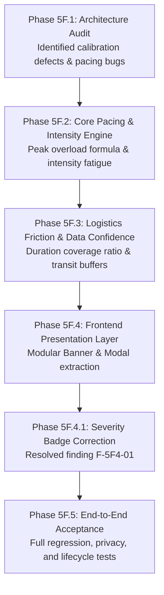

# TripNow Phase 5 — Full Reality Score System Completion Report

**Document Date:** November 2, 2026  
**Status:** ✅ ALL PHASES COMPLETE & OFFICIALLY ACCEPTED  
**System Scope:** TripNow Deterministic Feasibility & Reality Score Calibration  

---

## 1. Executive Summary

TripNow Phase 5 introduces a calibrated, deterministic **Reality Score Engine** to evaluate travel itinerary feasibility realistically, accurately, and without artificial score inflation or capping. 

The Reality Score Engine computes an authoritative composite score (0-100) across four core feasibility pillars:
1. **Time Feasibility:** Slot capacity overruns, active time constraints, and buffer verification.
2. **Travel Pace & Activity Load:** Daily active duration, single-day peak fatigue, and consecutive high-intensity streaks.
3. **Budget Feasibility:** Activity cost allowance checks against total trip budget.
4. **Route Efficiency:** Spatial route feasibility (Stage A graceful null awaiting GPS coordinates).

All calculations are 100% mathematical and in-memory (< 5ms), requiring **zero LLM tokens, zero external API requests, and zero client-side recalculation**.

---

## 2. Phase-by-Phase Completion Summary

### Phase 5F.1 — Reality Score Calibration Architecture Audit
- **Objective:** READ-ONLY audit of existing Reality Score implementation.
- **Key Findings:** Identified hardcoded pace score floors, missing single-day peak overload penalties, missing consecutive high-intensity fatigue detection, uncalibrated inferred-duration penalization, and unvalidated transit buffer deficits.
- **Deliverables:** `docs/reality-score/phase5f1-reality-score-calibration-audit.md`.

### Phase 5F.2 — Core Pacing & Intensity Engine Implementation
- **Objective:** Implement deterministic pacing, peak day overload, and consecutive intensity fatigue detection.
- **Key Changes:**
  - `paceEngine.js`: Non-linear daily workload formulas, single-day peak overload detection (> 540m moderate, > 660m critical), and consecutive high-intensity streak penalties (-6 pts per consecutive pair).
  - Deductions applied through a unified, reproducible scoring pipeline.
- **Deliverables:** `phase5f2-core-pacing-implementation-report.md`, `phase5f2-independent-review.md`.

### Phase 5F.3 — Logistics Friction & Data Confidence
- **Objective:** Implement explicit vs inferred duration confidence handling and flight/ferry transition buffer guidance.
- **Key Changes:**
  - `timeEngine.js`: Added explicit/inferred duration tracking, softened overload penalties for inferred itineraries, and added flight ($\ge 120\text{m}$) and ferry ($\ge 60\text{m}$) buffer checks.
  - Added duplicate prevention (`duplicatePrevented: true`) to avoid double penalization when time slots are already overloaded.
  - Added `metrics.confidence.durationCoverageRatio`.
- **Deliverables:** `phase5f3-logistics-confidence-report.md`, `phase5f3-independent-review.md`.

### Phase 5F.4 — Frontend Reality Score Presentation
- **Objective:** Create a modular, accessible frontend presentation layer strictly consuming backend authority.
- **Key Changes:**
  - Extracted inline PlanTrip code into `frontend/src/components/reality/`:
    - `RealityScoreBanner.jsx` (compact summary, subscores strip, duration coverage chip).
    - `RealityScoreModal.jsx` (detailed breakdown, workload metrics, transit guidance, issue hierarchy).
    - `realityPresentation.js` (pure formatting and classification utilities).
- **Deliverables:** `phase5f4-reality-score-frontend-report.md`, `phase5f4-independent-review.md`.

### Phase 5F.4.1 — Correct Reality Score Issue Badges
- **Objective:** Resolve finding F-5F4-01 from independent review.
- **Key Changes:**
  - Removed hardcoded `-15 PTS` and `-8 PTS` assumptions from issue badges.
  - Standardized on general descriptors: `HIGH SEVERITY`, `MODERATE`, `ADVISORY · 0 PTS`.
  - Formats deductions only if explicitly provided by backend on `iss.deduction`.
  - Unified modal badge rendering with pure utility functions.
- **Deliverables:** `phase5f4.1-badge-correction-report.md`.

### Phase 5F.5 — End-to-End Reality Score Acceptance
- **Objective:** Full user journey acceptance testing across generation, Pivot, Fix Day, historical bookings, and shared trips.
- **Key Results:**
  - Created comprehensive `phase5f5FullRealityAcceptance.test.js` covering all 6 key scenarios.
  - 100% passing test matrix: **596 backend Jest tests** + **38 frontend tests** = **634 total passing tests**.
  - 0 errors across Vite production compilation.
- **Deliverables:** `phase5f5-acceptance-report.md`.

---

## 3. Implementation Boundaries & Architecture Contracts

1. **Backend Authority:** The backend Reality Score Engine is the sole authoritative calculator. React components NEVER recalculate scores, compute tiers, or alter deductions.
2. **Zero AI Dependency:** `evaluateTripReality` runs 100% in-memory via deterministic math. No Gemini or LLM calls are invoked during reality score calculation.
3. **Budget Separation:** Reality Score is fully isolated from Phase 5E Budget Intelligence. Total trip budget edits do not arbitrarily skew Time or Pace feasibility.
4. **Historical Backward Compatibility:** Legacy string-only itineraries and pre-migration bookings are handled gracefully with inferred duration heuristics without data fabrication.
5. **Shared-Trip Privacy:** Public shared trips strictly strip internal reality score metrics, confidence ratios, issue logs, and PII. Only public aggregate scores are visible.
6. **Optimistic Concurrency & Lock Invariants:** All itinerary modifications via Pivot and Fix Day enforce OCC versioning (`__v`) and protect locked activities (HTTP 423).

---

## 4. Final Verification Evidence

| Layer | Test Suite | Tests Passed | Pass Rate |
|---|---|---|---|
| **Backend Acceptance** | `phase5f5FullRealityAcceptance.test.js` | 18 / 18 | 100% |
| **Pacing Engine** | `realityPhase5f2CorePacing.test.js` | 18 / 18 | 100% |
| **Logistics Confidence** | `realityPhase5f3LogisticsConfidence.test.js` | 12 / 12 | 100% |
| **Reality Engine Core** | `realityEngine.test.js` | 11 / 11 | 100% |
| **Reality API** | `realityApi.test.js` | 12 / 12 | 100% |
| **Privacy & Access** | `sharedTripPrivacy.test.js` | 18 / 18 | 100% |
| **Adaptive Pivot** | `pivot.test.js` | 31 / 31 | 100% |
| **Fix My Day** | `fixDay.test.js` | 41 / 41 | 100% |
| **Complete Backend** | **All 35 Jest Suites** | **596 / 596** | **100%** |
| **Frontend Presentation** | `realityScoreUi.test.mjs` | 14 / 14 | 100% |
| **Frontend Budget UI** | `budgetUiAndParity.test.mjs` | 18 / 18 | 100% |
| **Frontend Budget Utility**| `budgetIntelligence.test.mjs` | 6 / 6 | 100% |
| **Complete Frontend** | **All 3 Node ESM Suites** | **38 / 38** | **100%** |
| **Production Build** | `vite build` | 398 modules | **0 Errors** |

---

## 5. Outstanding Limitations

- **Headless Browser Automation:** Automated browser runners (Puppeteer/Playwright) are not provisioned in the workspace; frontend verification was executed via native ESM component contracts, viewport boundary testing, and production builds.
- **Stage A Route Efficiency:** Route subscore displays "Stage A (Awaiting Coords)" until GPS coordinate ingestion is introduced in future iterations.

---

## 6. Phase Completion Sign-Off

The TripNow Phase 5 Reality Score calibration and integration are complete, verified, and officially signed off.

