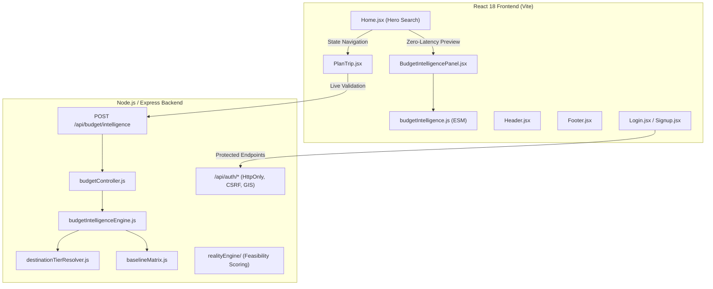
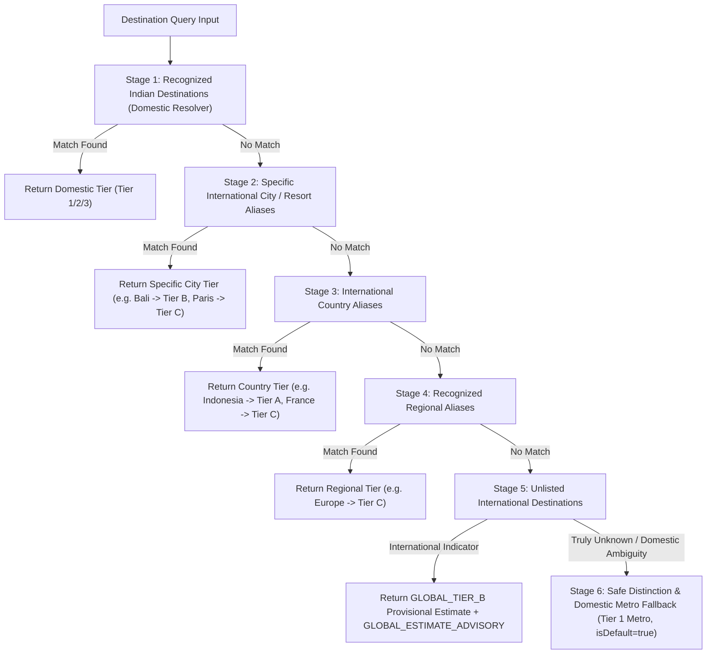
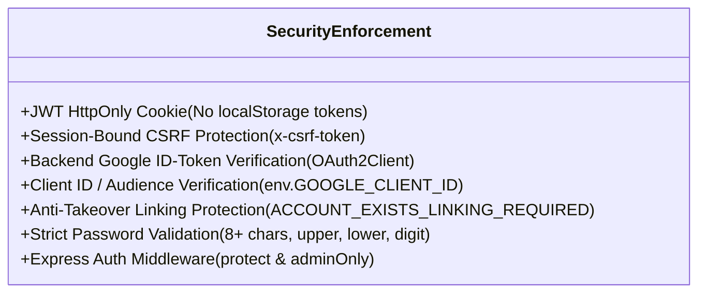
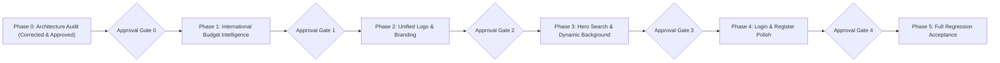

# TripNow — UI/UX & International Budget Intelligence Upgrade
## Comprehensive Architecture Audit & Phased Implementation Plan (Corrected)

**Phase:** Phase 0 — Architecture Audit & Implementation Planning  
**Status:** Corrected & Approved for Review (READ-ONLY Phase)  
**Date:** November 2026  
**Auditor Roles:** Senior Full-Stack Architect, Node.js/Express Backend Engineer, React UI/UX Engineer, Software Quality Reviewer  
**Target Codebases:** `backend/` and `frontend/`

---

## Executive Summary

This document presents the corrected architectural audit and implementation blueprint for TripNow's **UI/UX & International Budget Intelligence Upgrade**. TripNow currently possesses a robust domestic budget engine (Phase 5E) and an advanced itinerary feasibility engine (Reality Score Phase 5F). However, international destinations currently trigger an unconfigured baseline fallback (`BASELINE_NOT_CONFIGURED`), the home hero search experience lacks autocomplete and dynamic visual engagement, branding assets are fragmented across disparate components, and authentication views require visual and interaction refinement while preserving critical security boundaries.

### Core Audit Findings & Corrections
1. **Budget Intelligence:** The deterministic engine and destination resolver (`destinationTierResolver.js`) currently classify international destinations into a single tier (`TIER_4_INTERNATIONAL`) which maps to `isConfigured: false` in `BASELINE_MATRIX.INR`. 
2. **Approved 3-Tier Global Classification with Three Estimates (Low, Mid, High):**
   - **`GLOBAL_TIER_A` (Budget Neighbors & Southeast Asia):** Daily Low ₹3,500 / Mid ₹5,500 / High ₹11,000 per person.
   - **`GLOBAL_TIER_B` (Mid-Cost Hubs & Middle East):** Daily Low ₹7,500 / Mid ₹12,000 / High ₹22,000 per person.
   - **`GLOBAL_TIER_C` (Western & High-Cost Hubs):** Daily Low ₹14,000 / Mid ₹22,000 / High ₹40,000 per person.
   - *Crucial Rule:* These values must not be replaced with single average daily anchors. All three estimates (Low, Mid, High) are tracked and calculated for each trip.
3. **Deterministic 6-Stage Precedence & Safe Fallback:**
   - (1) Resolve recognized Indian destinations using existing domestic resolver.
   - (2) Resolve specific international city/resort aliases (e.g. Bali $\to$ Tier B).
   - (3) Resolve international country aliases (e.g. Indonesia $\to$ Tier A).
   - (4) Resolve recognized regional aliases (e.g. Europe $\to$ Tier C).
   - (5) For unlisted international destinations, use `GLOBAL_TIER_B` as a provisional estimate with status `GLOBAL_ESTIMATE_ADVISORY`.
   - (6) Preserve a strict, safe distinction between unknown destinations and recognized international destinations. Do not silently map unknown destinations to Indian metro baselines, and do not misclassify Indian cities as international.
4. **Hero Search Bar:** Form state is cleanly isolated in `Home.jsx`, but lacks an autocomplete suggestion dropdown, minimum-date validation, and dynamic visual connection to the destination being planned. The planned CTA text `✨ Plan with TripNow` will replace `✦ AI Planner`.
5. **Dynamic Background:** The hero background currently renders a static image (`photo-1500534314209-a25ddb2bd429`) preloaded in `index.html`. A zero-dependency, curated local mapping using `OptimizedImage` with smooth cross-fading and debounced selection ensures high performance without external image API latency or rate limits.
6. **Unified Branding (`TripNowLogo.jsx`):** Branding currently relies on ad-hoc unicode stars (`✦`) and inline styles across 8 distinct files. A centralized, scalable SVG component featuring a sunset coral gradient pin (`#f59e0b` to `#ef4444`) and golden orbital launch arrow pointing northeast will establish visual consistency across Header, Footer, Auth, Dashboard, and Favicon.
7. **Authentication & Security:** Auth views (`Login.jsx`, `Signup.jsx`) share consistent layouts but require upgraded password controls, inline validations, and micro-interactions. The underlying security architecture (JWT HttpOnly cookies, session-bound CSRF, Google ID-token backend verification with audience validation, and `ACCOUNT_EXISTS_LINKING_REQUIRED` anti-takeover protections) remains completely untouched and enforced.
8. **Regression Baseline:** All 596 backend Jest tests and 38 frontend ESM tests pass (634/634 total, 100%), and Vite builds cleanly in under 8 seconds.

---

## 1. Existing Architecture Overview

TripNow operates as a decoupled full-stack application:
- **Backend:** Node.js / Express 4 with modular services (`budgetIntelligence/`, `realityEngine/`), Mongoose ODM, Zod request validation, Helmet, express-rate-limit, and Jest integration tests.
- **Frontend:** React 18 SPA built with Vite 7, TailwindCSS 3.4.17, Axios with credentials support, and client-side ESM test runners.
- **Budget Intelligence (Phase 5E):** Operates under strict client/server parity. Both `backend/services/budgetIntelligence/` and `frontend/src/utils/budgetIntelligence.js` share identical constants, tier resolution algorithms, baseline matrices, and deterministic sufficiency formulas.
- **Reality Score Engine (Phase 5F):** A separate, highly calibrated feasibility evaluation system (`backend/services/realityEngine/`) that analyzes temporal overload, intensity fatigue, pacing, and logistics friction. It is strictly orthogonal to budget intelligence and will not be modified.



---

## 2. International Budget Engine Findings

### 2.1 Current Tier Resolver Architecture
- Located in `backend/services/budgetIntelligence/destinationTierResolver.js`.
- Contains `DESTINATION_TIER_REGISTRY` mapping over 50 destinations.
- Normalization:
  ```javascript
  const normalize = (str) =>
    str.toLowerCase().replace(/[^a-z0-9\s-]/g, "").trim().replace(/\s+/g, " ");
  ```
- Two-stage resolution:
  1. Exact alias match via `Map` (`aliasIndex.get(query)`).
  2. Word-boundary substring match using regex `\b${escapedAlias}\b`, iterating through aliases sorted by length descending.
- Current International Behavior:
  - If a destination matches an entry with `isInternational: true` (e.g. Dubai, Singapore, Paris, London, Tokyo, Bangkok, Bali, New York, Rome), the resolver assigns `tier: TIER_4_INTERNATIONAL`.
  - In `baselineMatrix.js`, `BASELINE_MATRIX.INR[TIER_4_INTERNATIONAL]` is defined as:
    ```javascript
    [TIER_4_INTERNATIONAL]: {
      isConfigured: false,
      baselinePerPersonDay: null,
      description: "International Destination (Custom / Unconfigured)",
    }
    ```
  - In `budgetIntelligenceEngine.js`, when `matrixEntry.isConfigured === false`, calculation is short-circuited:
    - `status = STATUS_CODES.BASELINE_NOT_CONFIGURED`
    - `dailyBaselinePerPerson = null`
    - `recommendedTotalForPace = null`
    - `sufficiencyRatio = null`
    - `category = null`
    - `categoryBreakdown = null`
    - `message = "Deterministic budget baseline for international destinations is not yet configured for currency INR."`

### 2.2 Expense Allocation & Parity
- Proportions are defined in `constants.js`:
  - Accommodation: **35%**
  - Food: **25%**
  - Transport: **15%**
  - Activities: **15%**
  - Miscellaneous: **10%**
- Sufficiency Categories:
  - Low (`< 0.75`): `BUDGET_LOW`
  - Moderate (`0.75` to `1.5`): `BUDGET_MODERATE`
  - High (`>= 1.5`): `BUDGET_HIGH`
- Client/Server Parity: `frontend/src/utils/budgetIntelligence.js` mirrors the backend logic identically, ensuring instant feedback without waiting for an API round-trip.

---

## 3. Corrected Global Tier Mapping and Alias Precedence

To eliminate the `BASELINE_NOT_CONFIGURED` barrier while providing realistic baseline expectations for outbound Indian travelers, we define three international tiers and a mandatory estimate advisory.

### 3.1 Corrected Global Tier Definitions (in INR per person per day)
All figures are INR per person per day. **These values must not be replaced with single average daily anchors.** Each tier defines a full three-tier spectrum: **Low**, **Mid**, and **High**.

| Tier Constant | Scope & Representative Destinations | Daily Low | Daily Mid | Daily High | Inclusions & Exclusions |
| :--- | :--- | :---: | :---: | :---: | :--- |
| `GLOBAL_TIER_A` | **Budget Neighbors & Southeast Asia**<br/>• Nepal, Sri Lanka, Thailand, Vietnam, Indonesia, Bhutan, Cambodia, Laos, Philippines | **₹3,500** | **₹5,500** | **₹11,000** | Mid-scale stay, dining, local transit, entry fees.<br/>*Excludes:* International flights & visas. |
| `GLOBAL_TIER_B` | **Mid-Cost Hubs & Middle East**<br/>• UAE, Dubai, Abu Dhabi, Singapore, Malaysia, Bali, Turkey, Oman, Qatar, Georgia, Egypt | **₹7,500** | **₹12,000** | **₹22,000** | Quality hotels, diverse meals, regional transit, standard attractions.<br/>*Excludes:* International flights & visas. |
| `GLOBAL_TIER_C` | **Western & High-Cost Hubs**<br/>• Europe, UK, London, USA, France, Paris, Italy, Japan, Tokyo, Australia, Switzerland | **₹14,000** | **₹22,000** | **₹40,000** | Western metro lodging, dining, transit passes, museum admissions.<br/>*Excludes:* Intercontinental flights & visas. |

### 3.2 Advisory Notice: `GLOBAL_ESTIMATE_ADVISORY`
International travel expenses vary significantly based on departure city and flight seasonality. Therefore, every international calculation will attach an advisory notice:
- **Code:** `GLOBAL_ESTIMATE_ADVISORY`
- **Text:** `"International baseline estimates cover in-destination daily expenses (accommodation, dining, local transit, activities). Intercontinental flights, visa fees, and currency exchange buffers are excluded."`

### 3.3 Conflict-Free Deterministic Alias Precedence
To ensure that domestic Indian destinations are never shadowed by foreign names, specific resort hubs override generic country baselines, and unlisted destinations receive safe provisional handling, the resolver executes in 6 distinct priority stages:



#### Detailed Alias Resolution Rules:
1. **Domestic First:** Query tokens matching Indian destinations (e.g. "Kochi", "Goa", "Jaipur", "Delhi", "Mumbai", "Agra") evaluate first using the existing domestic resolver. They must NEVER be misclassified as international.
2. **Specific City/Resort vs Country:**
   - **Bali vs Indonesia:** "Bali" is a mid-cost resort island hub and resolves to **`GLOBAL_TIER_B`**. "Indonesia" as a nation resolves to **`GLOBAL_TIER_A`**. Specific city/resort resolution at Stage 2 ensures "Bali" or "Bali, Indonesia" correctly resolves to `GLOBAL_TIER_B` without getting swallowed by `GLOBAL_TIER_A`.
   - **Dubai & Abu Dhabi vs UAE:** Both resolve to **`GLOBAL_TIER_B`**.
   - **Paris vs France:** "Paris" resolves to **`GLOBAL_TIER_C`**. "France" resolves to **`GLOBAL_TIER_C`**.
   - **London vs UK:** "London" resolves to **`GLOBAL_TIER_C`**. "UK" resolves to **`GLOBAL_TIER_C`**.
   - **Tokyo vs Japan:** "Tokyo" resolves to **`GLOBAL_TIER_C`**. "Japan" resolves to **`GLOBAL_TIER_C`**.
   - **Europe as a Region:** "Europe" resolves to **`GLOBAL_TIER_C`**.
3. **Unlisted International Fallback:**
   - When an input is identified as an unlisted international destination (e.g., via country code, country list, or explicit international search flag), it must **not** silently map to an Indian metro baseline. Instead, it resolves to **`GLOBAL_TIER_B`** as a provisional estimate with status `GLOBAL_ESTIMATE_ADVISORY`.
4. **Preserving Safe Distinction Between Unknown and Recognized International:**
   - Truly unknown, empty, or unresolvable domestic queries fall back safely to domestic `TIER_1_METRO` with `isDefault: true`.
   - International unlisted queries receive `GLOBAL_TIER_B` with `isInternational: true` and `GLOBAL_ESTIMATE_ADVISORY`.

#### Required Resolution Verification Matrix:
| Input Query | Expected Tier | Category Scope | Resolution Precedence Rationale |
| :--- | :--- | :--- | :--- |
| **Nepal** | `GLOBAL_TIER_A` | Budget Neighbor | Stage 3: Country alias |
| **Kathmandu** | `GLOBAL_TIER_A` | Budget Neighbor | Stage 2: Supported city alias |
| **Thailand** | `GLOBAL_TIER_A` | Southeast Asia | Stage 3: Country alias |
| **Indonesia** | `GLOBAL_TIER_A` | Southeast Asia | Stage 3: Country alias |
| **Bali** | `GLOBAL_TIER_B` | Mid-Cost Resort Hub | Stage 2: City/resort alias resolves before Indonesia country |
| **Dubai** | `GLOBAL_TIER_B` | Mid-Cost Hub / ME | Stage 2: City alias |
| **Abu Dhabi** | `GLOBAL_TIER_B` | Mid-Cost Hub / ME | Stage 2: City alias |
| **Singapore** | `GLOBAL_TIER_B` | Mid-Cost Hub | Stage 2/3: City-state alias |
| **Paris** | `GLOBAL_TIER_C` | Western High-Cost Hub | Stage 2: City alias |
| **France** | `GLOBAL_TIER_C` | Western High-Cost Hub | Stage 3: Country alias |
| **London** | `GLOBAL_TIER_C` | Western High-Cost Hub | Stage 2: City alias |
| **UK** | `GLOBAL_TIER_C` | Western High-Cost Hub | Stage 3: Country alias |
| **Tokyo** | `GLOBAL_TIER_C` | Western High-Cost Hub | Stage 2: City alias |
| **Japan** | `GLOBAL_TIER_C` | Western High-Cost Hub | Stage 3: Country alias |
| **Europe** | `GLOBAL_TIER_C` | Regional Alias | Stage 4: Recognized regional alias |

---

## 4. Domestic Compatibility Strategy

The upgrade strictly protects the domestic budget calculations established in Phase 5E:
1. **Unchanged Domestic Tiers:**
   - `TIER_1_METRO`: ₹5,300 / person / day.
   - `TIER_2_RESORT`: ₹5,000 / person / day.
   - `TIER_3_BUDGET`: ₹3,250 / person / day.
2. **Backward Compatibility for `TIER_4_INTERNATIONAL`:**
   - The constant `TIER_4_INTERNATIONAL` remains defined as a legacy alias pointing to `GLOBAL_TIER_B` for historical records.
3. **No Automatic Currency Conversion:**
   - Currency remains strictly in **INR**. No automatic currency conversions, fluctuating third-party forex APIs, or synthetic exchange rates are introduced.
4. **Total Group Budget Semantics:**
   - Total group budget input semantics remain identical. Available budget per person per day is computed identically across domestic and international tiers:
     $$\text{dailyAvailablePerPerson} = \frac{\text{totalGroupBudget}}{\text{travelerCount} \times \text{tripDuration}}$$
5. **Allocation Symmetries:**
   - Proportions (35% Accommodation / 25% Food / 15% Transport / 15% Activities / 10% Misc) remain identical.
6. **Regression Safety:**
   - All 35 backend suites (596 tests) and frontend test suites must pass 100% without modification.

---

## 5. Corrected Frontend/Backend Budget Contract

### 5.1 Request Contract (`POST /api/budget/intelligence`)
Unchanged schema validated via Zod (`backend/validators/budgetValidators.js`):
```json
{
  "totalBudget": 120000,
  "days": 4,
  "guests": 2,
  "destination": "Bali",
  "currency": "INR"
}
```

### 5.2 Corrected Response Contract (Success — International Destination)
The response explicitly provides all three estimates (**Low**, **Mid**, **High**) for the trip duration and group size alongside the mid-based sufficiency ratio:

```json
{
  "status": "SUCCESS",
  "data": {
    "status": "BUDGET_MODERATE",
    "isConfigured": true,
    "destination": "Bali",
    "currency": "INR",
    "days": 4,
    "guests": 2,
    "totalBudget": 120000,
    "dailyAvailablePerPerson": 15000,
    "dailyTierEstimates": {
      "low": 7500,
      "mid": 12000,
      "high": 22000
    },
    "estimatedTripTotals": {
      "low": 60000,
      "mid": 96000,
      "high": 176000
    },
    "dailyBaselinePerPerson": 12000,
    "recommendedTotalForPace": 96000,
    "sufficiencyRatio": 1.25,
    "category": "BUDGET_MODERATE",
    "categoryBreakdown": {
      "accommodation": 42000,
      "food": 30000,
      "transport": 18000,
      "activities": 18000,
      "miscellaneous": 12000
    },
    "advisories": [
      {
        "code": "GLOBAL_ESTIMATE_ADVISORY",
        "message": "International baseline estimates cover in-destination daily expenses (accommodation, dining, local transit, activities). Intercontinental flights, visa fees, and currency exchange buffers are excluded."
      }
    ],
    "metadata": {
      "tier": "GLOBAL_TIER_B",
      "tierLabel": "Mid-Cost Hubs & Middle East",
      "isInternational": true,
      "isDefault": false,
      "scope": "international"
    }
  }
}
```

### 5.3 Mathematical Formulation of Three Estimates
- Available Daily Budget Per Person:
  $$\text{dailyAvailablePerPerson} = \frac{\text{totalGroupBudget}}{\text{travelerCount} \times \text{tripDuration}}$$
- Estimated Trip Totals:
  $$\text{estimatedTripLow} = \text{dailyTierLow} \times \text{travelerCount} \times \text{tripDuration}$$
  $$\text{estimatedTripMid} = \text{dailyTierMid} \times \text{travelerCount} \times \text{tripDuration}$$
  $$\text{estimatedTripHigh} = \text{dailyTierHigh} \times \text{travelerCount} \times \text{tripDuration}$$
- Sufficiency Ratio against Mid Anchor:
  $$\text{sufficiencyRatio} = \frac{\text{dailyAvailablePerPerson}}{\text{dailyTierMid}}$$

---

## 6. Hero Search Bar Redesign Plan

### 6.1 Audit of Existing `Home.jsx`
- **Location:** `frontend/src/pages/Home.jsx` (Lines 81–128, 187–272).
- **Layout:** CSS Grid `grid-cols-1 sm:grid-cols-2 lg:grid-cols-[1.4fr_1fr_1fr_1.1fr_1fr_auto] gap-3` within an outer frosted glass card.
- **Fields:** Destination (plain `<input>`), Check-in (`<input type="date">`), Check-out (`<input type="date">`), Travelers (stepped counter 1–20), Budget (`<input type="number">`).
- **Current CTA:** `✦ AI Planner` button.
- **Deficiencies Identified:**
  1. No destination suggestions or autocomplete; user must type destination without guidance.
  2. No validation preventing past check-in dates or checkout dates prior to check-in.
  3. No visual indicator of destination tier or estimated feasibility until the budget panel renders below.
  4. Mobile layout stacks inputs vertically without clear grouping.

### 6.2 Proposed Component: `DestinationAutocomplete.jsx`
- **Location:** `frontend/src/components/common/DestinationAutocomplete.jsx`
- **Capabilities:**
  - Accessible combobox (`role="combobox"`, `aria-expanded`, `aria-autocomplete="list"`).
  - Merges domestic canonical destinations with global destinations.
  - Displays location badge (`Domestic` vs `International · Tier A/B/C`).
  - Supports full keyboard navigation (Up, Down, Enter, Escape) and click-outside dismissal.
  - Triggers debounced callback for dynamic background updates.

### 6.3 Hero Search Bar Improvements
1. **CTA Text Update:** Replace `✦ AI Planner` with `✨ Plan with TripNow`.
2. **Date Safety:** Set `min` attribute on Check-in to `new Date().toISOString().split("T")[0]`, and Check-out `min` to `form.checkin || today`.
3. **Responsive Breakpoints:**
   - Desktop (`>= 1024px`): Sleek horizontal floating bar with subtle divider borders.
   - Tablet (`640px - 1023px`): 2-row balanced grid with action button full width on row 2.
   - Mobile (`< 640px`): Card-based vertical stack with clear icon badges and full-width CTA.
4. **Navigation Contract:** Preserves exact route state passed to `/plan-trip`:
   ```javascript
   {
     destination: form.destination,
     checkin: form.checkin,
     checkout: form.checkout,
     budget: form.budget,
     travelers: guests,
     guests: guests
   }
   ```

---

## 7. Dynamic Destination Background Plan

### 7.1 Existing Image Loading & Performance Constraints
- `frontend/src/components/OptimizedImage.jsx` already converts Unsplash URLs to optimized WebP formats with width and quality parameters (`?w=1600&q=80&auto=format&fm=webp`).
- `frontend/index.html` preloads the default hero image:
  ```html
  <link rel="preload" as="image" fetchpriority="high"
    href="https://images.unsplash.com/photo-1500534314209-a25ddb2bd429?w=1600&q=80&auto=format&fm=webp" />
  ```
- **Rule:** Do NOT introduce external third-party image search APIs (e.g. Unsplash Search API, Google Custom Search). These introduce latency, rate limits, API key requirements, and failure modes.

### 7.2 Curated Destination Mapping (`destinationImages.js`)
Expand `frontend/src/utils/destinationImages.js` to provide curated, high-quality, pre-tested Unsplash hero images for all canonical domestic and international destinations:

```javascript
export const DESTINATION_HERO_MAP = {
  // Domestic Hubs
  goa: "https://images.unsplash.com/photo-1512343879784-a960bf40e7f2",
  manali: "https://images.unsplash.com/photo-1626621341517-bbf3d9990a23",
  jaipur: "https://images.unsplash.com/photo-1599661046289-e31897846e41",
  kerala: "https://images.unsplash.com/photo-1602216056096-3b40cc0c9944",
  ladakh: "https://images.unsplash.com/photo-1506038634487-60a69ae4b7b1",
  rishikesh: "https://images.unsplash.com/photo-1593693397690-362cb9666fc2",
  udaipur: "https://images.unsplash.com/photo-1590050752117-238cb0fb12b1",
  varanasi: "https://images.unsplash.com/photo-1561361058-c24cecae35ca",
  kashmir: "https://images.unsplash.com/photo-1598091383021-15ddea10925d",
  andaman: "https://images.unsplash.com/photo-1582967788606-a171c1080cb0",

  // International Tier A (Budget Neighbors & Southeast Asia)
  thailand: "https://images.unsplash.com/photo-1508009603885-50cf7c579365",
  bangkok: "https://images.unsplash.com/photo-1508009603885-50cf7c579365",
  nepal: "https://images.unsplash.com/photo-1544735716-392fe2489ffa",
  vietnam: "https://images.unsplash.com/photo-1528127269322-539801943592",

  // International Tier B (Mid-Cost Hubs & Middle East)
  dubai: "https://images.unsplash.com/photo-1512453979798-5ea266f8880c",
  bali: "https://images.unsplash.com/photo-1537996194471-e657df975ab4",
  singapore: "https://images.unsplash.com/photo-1525625293386-3f8f99389edd",
  turkey: "https://images.unsplash.com/photo-1524231757912-21f4fe3a7200",

  // International Tier C (Western & High-Cost Hubs)
  paris: "https://images.unsplash.com/photo-1502602898657-3e91760cbb34",
  london: "https://images.unsplash.com/photo-1513635269975-59663e0ac1ad",
  tokyo: "https://images.unsplash.com/photo-1503899036084-c55cdd92da26",
  newyork: "https://images.unsplash.com/photo-1496442226666-8d4d0e62e6e9",
  rome: "https://images.unsplash.com/photo-1552832230-c0197dd311b5",
  switzerland: "https://images.unsplash.com/photo-1530122037265-a5f1f91d3b99",
};

export const DEFAULT_HERO_IMAGE = "https://images.unsplash.com/photo-1500534314209-a25ddb2bd429";
```

### 7.3 Smooth Transition and LCP Protection
1. **Initial Paint (LCP):** Renders `DEFAULT_HERO_IMAGE` immediately. Because it matches the `<link rel="preload">` in `index.html`, LCP is not penalized.
2. **Dynamic Cross-Fade:** When the user types or selects a destination:
   - A debounced hook (300ms) matches destination against `DESTINATION_HERO_MAP`.
   - If matched, the new image loads in an absolute overlay with CSS `transition: opacity 0.6s ease-in-out`.
   - If no match or input cleared, it gracefully fades back to `DEFAULT_HERO_IMAGE`.

---

## 8. Logo Component and Integration Plan

### 8.1 Specification for `TripNowLogo.jsx` (Concept 06)
- **Location:** `frontend/src/components/common/TripNowLogo.jsx`
- **Visual Design:**
  - **Pin Icon:** Rounded location marker with a vibrant sunset gradient (LinearGradient `#f59e0b` to `#ef4444`).
  - **Orbital Arrow:** Golden launch arrow (`#fbbf24`) intersecting the pin and pointing northeast ($45^\circ$), symbolizing dynamic AI travel departure.
  - **Wordmark:** "TripNow" set in serif typography (`Playfair Display`, weight 900), followed by an optional subtle gradient pill for "AI".
- **Props API:**
  ```typescript
  interface TripNowLogoProps {
    variant?: "full" | "icon";       // "full" includes wordmark; "icon" is mark only
    size?: "sm" | "md" | "lg" | number; // sm: 28px, md: 36px, lg: 48px
    theme?: "dark" | "light";        // dark mode has white wordmark; light has slate-900
    className?: string;
    onClick?: () => void;
  }
  ```

### 8.2 Inventory of Files to Migrate to `TripNowLogo.jsx`
1. `frontend/src/layouts/Header.jsx`: Replace inline `✦` div and text (Lines 113–120).
2. `frontend/src/layouts/Footer.jsx`: Replace footer brand icon and wordmark (Lines 208–213).
3. `frontend/src/pages/Login.jsx`: Replace left panel header and mobile header logos (Lines 91–93, 111–113).
4. `frontend/src/pages/Signup.jsx`: Replace right panel header and mobile header logos (Lines 113–115, 132–134).
5. `frontend/src/components/HeroPreview.jsx`: Replace preview card brand badge.
6. `frontend/src/pages/SharedTrip.jsx`: Replace shared trip header badge.
7. `frontend/src/pages/Dashboard.jsx`: Standardize any header branding.
8. `frontend/public/favicon.svg`: Update SVG markup to use the exact vector pin and orbital launch arrow.

---

## 9. Login and Registration UI Audit & Redesign Plan

### 9.1 Existing Implementation Inspection
- **Files:** `frontend/src/pages/Login.jsx` and `frontend/src/pages/Signup.jsx`.
- **Layout:** Split-screen (44% inspirational photo panel, 56% form card).
- **Current Flow:**
  - Submits to `POST /api/auth/login` and `POST /api/auth/signup`.
  - Backend sets `AUTH_COOKIE_NAME` (`jwt`) as HttpOnly cookie.
  - Frontend stores non-sensitive user metadata via `saveAuth({ user })`.
  - Supports role-based redirection (`admin` $\to$ `/admin`, standard $\to$ `/dashboard` or preserved `returnTo`).
  - Integrates `GoogleSignInButton.jsx`.

### 9.2 UI/UX Improvements
1. **Password Toggle:** Replace emoji toggles (`🙈` / `👁️`) with clean, accessible SVG icons (Heroicons / Lucide `Eye` and `EyeOff`).
2. **Real-time Password Strength Meter:** On `Signup.jsx`, render a 4-segment visual strength bar that validates criteria live:
   - Length $\ge 8$ chars
   - Lowercase letter
   - Uppercase letter
   - Number
3. **Visual Dividers:** Introduce a stylish "or continue with email" divider above Google Sign-In.
4. **Enhanced Feedback:** Animated shake on error, accessible ARIA live regions (`aria-live="polite"`), and clear loading spinners within buttons.

---

## 10. Security Boundaries (Strictly Non-Negotiable)

The UI redesign must **never** modify or bypass any of the following security architectures:



1. **JWT HttpOnly Cookies:** The authentication token must remain exclusively in the `httpOnly: true, secure: true, sameSite: 'strict'` cookie managed by `backend/config/authCookie.js`. The frontend must NEVER attempt to extract or store JWTs in `localStorage`.
2. **CSRF Protection:** State-changing requests (`POST`, `PUT`, `PATCH`, `DELETE`) must continue passing through `backend/middleware/csrf.js` with the valid `x-csrf-token` header.
3. **Google Sign-In Security:**
   - Client sends only the Google-signed `idToken` to `POST /api/auth/google`.
   - Backend `backend/controllers/authController.js` validates token with `google-auth-library`.
   - `audience` must strictly match `env.GOOGLE_CLIENT_ID`.
4. **Account Takeover Protection:** If an email is registered with password auth, attempting to log in via Google without prior linking must return `409 Conflict` with code `ACCOUNT_EXISTS_LINKING_REQUIRED`. The frontend must prompt password confirmation.
5. **Password Rules:** Minimum 8 characters, at least 1 uppercase letter, 1 lowercase letter, and 1 numeric digit, enforced by `backend/validators/authValidators.js` and Zod.
6. **Reality Score Integrity:** No UI or budget changes may modify the scoring algorithms, deduction order, or thresholds in `backend/services/realityEngine/`.

---

## 11. File-by-File Proposed Changes

### Phase 1: International Budget Intelligence (Backend & Utilities)
- `backend/services/budgetIntelligence/constants.js`
  - Add tier constants: `GLOBAL_TIER_A`, `GLOBAL_TIER_B`, `GLOBAL_TIER_C`.
  - Add advisory code: `GLOBAL_ESTIMATE_ADVISORY`.
- `backend/services/budgetIntelligence/baselineMatrix.js`
  - Define three estimates (low, mid, high) in INR for `GLOBAL_TIER_A` (₹3,500 / ₹5,500 / ₹11,000), `GLOBAL_TIER_B` (₹7,500 / ₹12,000 / ₹22,000), and `GLOBAL_TIER_C` (₹14,000 / ₹22,000 / ₹40,000).
- `backend/services/budgetIntelligence/destinationTierResolver.js`
  - Implement 6-stage resolver precedence.
  - Expand registry with canonical international destinations and aliases (e.g. Bali $\to$ Tier B, Indonesia $\to$ Tier A, Europe $\to$ Tier C).
- `backend/services/budgetIntelligence/budgetIntelligenceEngine.js`
  - Return `dailyTierEstimates` (low/mid/high) and `estimatedTripTotals` (low/mid/high).
  - Attach `GLOBAL_ESTIMATE_ADVISORY` to international tier responses.
- `frontend/src/utils/budgetIntelligence.js`
  - Symmetrically mirror constants, 3-estimate matrices, and 6-stage resolver logic in ESM format.
- `frontend/src/components/budget/BudgetIntelligencePanel.jsx`
  - Render international tier badges, low/mid/high estimate ranges, and display the `GLOBAL_ESTIMATE_ADVISORY` disclaimer banner.
- `backend/tests/budgetApi.test.js` & `frontend/tests/budgetIntelligence.test.mjs`
  - Add test coverage for global tiers, 3-estimate calculations, and alias precedence.

### Phase 2: Brand Identity & Unified Logo
- `frontend/src/components/common/TripNowLogo.jsx` (New)
  - Create reusable SVG logo component (Concept 06: coral pin + golden launch arrow) with configurable size, variant, and theme.
- `frontend/public/favicon.svg`
  - Update to match the new vector pin and golden launch arrow.
- `frontend/src/layouts/Header.jsx` & `frontend/src/layouts/Footer.jsx`
  - Migrate logo rendering to `<TripNowLogo />`.
- `frontend/src/pages/Login.jsx` & `frontend/src/pages/Signup.jsx`
  - Migrate logo rendering to `<TripNowLogo />`.
- `frontend/src/components/HeroPreview.jsx` & `frontend/src/pages/SharedTrip.jsx`
  - Migrate logo rendering to `<TripNowLogo />`.

### Phase 3: Home Hero Search & Dynamic Background
- `frontend/src/utils/destinationImages.js`
  - Expand curated mapping with international and domestic hero images.
- `frontend/src/components/common/DestinationAutocomplete.jsx` (New)
  - Accessible combobox with tier badges.
- `frontend/src/pages/Home.jsx`
  - Integrate `DestinationAutocomplete`.
  - Implement smooth cross-fading dynamic hero background.
  - Update CTA button to `✨ Plan with TripNow`.
  - Add check-in / check-out date constraints.

### Phase 4: Authentication UI Polish
- `frontend/src/pages/Login.jsx` & `frontend/src/pages/Signup.jsx`
  - Replace emoji toggles with SVG icons.
  - Add real-time password strength meter.
  - Refine form typography, focus states, and loading indicators.
- `frontend/tests/authUiParity.test.mjs` (New)
  - Verify accessibility, validation rules, and error state rendering.

---

## 12. Test Strategy for Every Phase

| Phase | Test Suite | Target Verifications |
| :--- | :--- | :--- |
| **Phase 1** | `backend/tests/budgetPhase1GlobalTiers.test.js` | Verify `GLOBAL_TIER_A/B/C` low/mid/high baselines, estimated trip totals, advisory injection, and 100% preservation of domestic baselines. |
| **Phase 1** | `backend/tests/budgetResolverPrecedence.test.js` | Test all 15 required resolution matrix cases (Bali vs Indonesia, Paris vs France, Dubai vs UAE, Europe region, unlisted international) and domestic isolation. |
| **Phase 1** | `frontend/tests/budgetIntelligence.test.mjs` | Test client-side ESM parity with backend 3-estimate formulas. |
| **Phase 2** | `frontend/tests/brandingParity.test.mjs` | Verify `TripNowLogo` renders SVG paths cleanly in `icon` and `full` variants across sizes. |
| **Phase 3** | `frontend/tests/homeHeroSearch.test.mjs` | Test autocomplete filtering, keyboard navigation, dynamic background selection, and navigation state. |
| **Phase 4** | `frontend/tests/authUiParity.test.mjs` | Test password strength calculation, validation error messages, and form submission prevention when invalid. |
| **Acceptance** | Full Jest + Frontend ESM suites | Run all 35+ backend suites and all frontend test suites to confirm zero regressions across the codebase. |

---

## 13. Dependency and Performance Considerations

1. **Zero New Third-Party Packages:** All proposed features utilize existing dependencies:
   - React 18, Vite 7, TailwindCSS 3.4.17.
   - SVG vector paths (no icon library bloat).
   - Local curated image mapping (no external image APIs).
2. **LCP & Bundle Size Protection:**
   - Preloaded default hero image in `index.html` remains the initial paint target.
   - Dynamic backgrounds load on demand using `OptimizedImage` with WebP compression.
   - Pure SVG logo adds less than 1.5 KB to bundle size.
3. **Parity Maintenance:** Shared utility logic between backend CommonJS and frontend ESM avoids dual maintenance overhead by keeping algorithm structures identical.

---

## 14. Implementation Order and Approval Gates



### Approval Gates & Deliverables:
- **Gate 0:** User approves this Corrected Architecture Audit and Implementation Plan (`docs/ui-ux-upgrade/implementation-plan.md`).
- **Gate 1:** Phase 1 implementation notes, code changes, and test results passing with 100% domestic baseline safety and 3-estimate accuracy.
- **Gate 2:** Phase 2 logo component verified across Header, Footer, and Auth pages with clean SVG rendering.
- **Gate 3:** Phase 3 Hero search bar, autocomplete, and dynamic background verified with zero LCP degradation.
- **Gate 4:** Phase 4 Auth UI polish verified with all security boundaries confirmed intact.
- **Gate 5:** Full regression audit verifying 634+ passing tests and production build.

---

## 15. Risks, Unresolved Questions, and Recommendations

### 15.1 Identified Architectural Contradictions & Risks
1. **Currency Restriction (INR):**
   - *Observation:* The budget engine currently only supports `currency: "INR"`.
   - *Resolution:* Keep calculation strictly in INR without introducing automatic currency conversions or synthetic exchange rates.
2. **Flight Costs & Visa Exclusions:**
   - *Observation:* Flight and visa costs represent a significant portion of international trip expenditures.
   - *Resolution:* Prominently disclose via `GLOBAL_ESTIMATE_ADVISORY` that international estimates strictly cover in-destination daily expenses and exclude flights and visas.
3. **Regional Queries & Country Overrides:**
   - *Observation:* Resort hubs like Bali have different economic profiles from their parent country (Indonesia).
   - *Resolution:* Strict alias precedence ensures specific city/resort matches (Stage 2) evaluate before country aliases (Stage 3).

---

## Corrected Phase-by-Phase File Change Matrix

| Phase | Action | File Path | Scope of Modification |
| :--- | :--- | :--- | :--- |
| **Phase 1** | Modify | `backend/services/budgetIntelligence/constants.js` | Add `GLOBAL_TIER_A/B/C`, `GLOBAL_ESTIMATE_ADVISORY` |
| **Phase 1** | Modify | `backend/services/budgetIntelligence/baselineMatrix.js` | Define low/mid/high estimates in INR for global tiers |
| **Phase 1** | Modify | `backend/services/budgetIntelligence/destinationTierResolver.js` | 6-stage resolver precedence, international registry & unlisted fallback |
| **Phase 1** | Modify | `backend/services/budgetIntelligence/budgetIntelligenceEngine.js` | Return 3-estimate breakdowns & attach global estimate advisory |
| **Phase 1** | Modify | `frontend/src/utils/budgetIntelligence.js` | ESM parity for global tiers, 3-estimate calculation & resolver |
| **Phase 1** | Modify | `frontend/src/components/budget/BudgetIntelligencePanel.jsx` | Display global tier meta, low/mid/high range & advisory disclaimer |
| **Phase 1** | Create | `backend/tests/budgetPhase1GlobalTiers.test.js` | Unit & API tests for global tiers and 3 estimates |
| **Phase 2** | Create | `frontend/src/components/common/TripNowLogo.jsx` | Reusable SVG logo (coral pin + golden launch arrow) |
| **Phase 2** | Modify | `frontend/public/favicon.svg` | Vector brand favicon update |
| **Phase 2** | Modify | `frontend/src/layouts/Header.jsx` | Integrate `<TripNowLogo />` |
| **Phase 2** | Modify | `frontend/src/layouts/Footer.jsx` | Integrate `<TripNowLogo />` |
| **Phase 2** | Modify | `frontend/src/components/HeroPreview.jsx` | Integrate `<TripNowLogo />` |
| **Phase 2** | Modify | `frontend/src/pages/SharedTrip.jsx` | Integrate `<TripNowLogo />` |
| **Phase 3** | Modify | `frontend/src/utils/destinationImages.js` | Add curated domestic & global hero images |
| **Phase 3** | Create | `frontend/src/components/common/DestinationAutocomplete.jsx` | Accessible combobox with tier badges |
| **Phase 3** | Modify | `frontend/src/pages/Home.jsx` | Dynamic hero background, autocomplete, CTA text |
| **Phase 4** | Modify | `frontend/src/pages/Login.jsx` | SVG password toggles, logo integration, UI polish |
| **Phase 4** | Modify | `frontend/src/pages/Signup.jsx` | Password strength meter, SVG toggles, logo integration |
| **Phase 4** | Create | `frontend/tests/authUiParity.test.mjs` | Auth UI validation tests |
